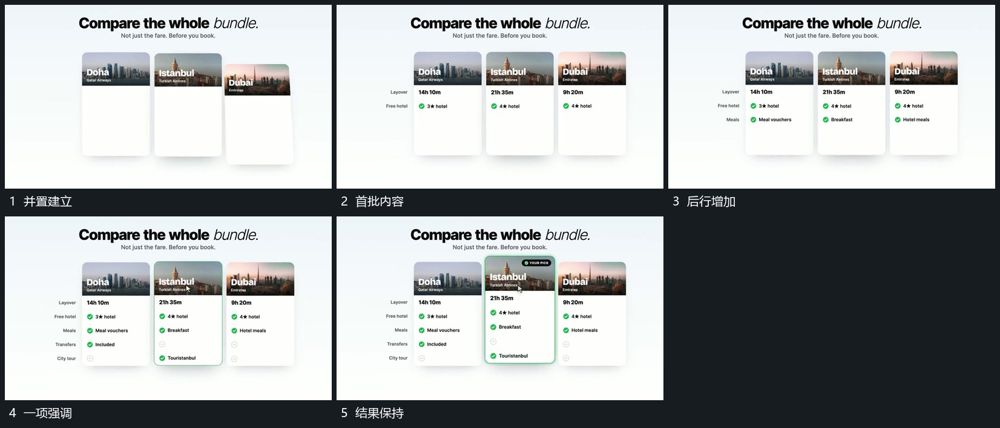

# 竖卡并置后内部逐行累计，单卡边界突出

## 运动指令

先稳定并置竖卡，在每张卡内逐行补入小标记与短文，已完成行不复原。最后突出其中一张边界，其余继续可见，随后推向局部。

## 视频切片

[播放本机制的原片切片](m02.mp4)

覆盖分镜中“并置建立”至“结果保持”的连续过程，并保留邻近的前后衔接画面；原片中交叠发生的动作一并保留。

## 分镜过程

## 组合与调整

可减少卡数，保持重点来自原集合；不要为突出项另造相同位置的新卡。
