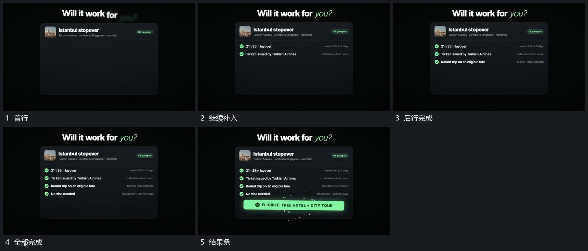

# 面板内完成点逐行出现，结果长条最后接入

## 运动指令

在固定面板里按由上至下顺序补入完成点和短文，前行保持，新行接续建立。所有行完成后底部结果长条接入，形成清楚收势。

## 视频切片

[播放本机制的原片切片](m03.mp4)

覆盖分镜中“首行”至“结果条”的连续过程，并保留邻近的前后衔接画面；原片中交叠发生的动作一并保留。

## 分镜过程

## 组合与调整

真实判定条件在新片另核；视觉上结果应在过程之后出现。
