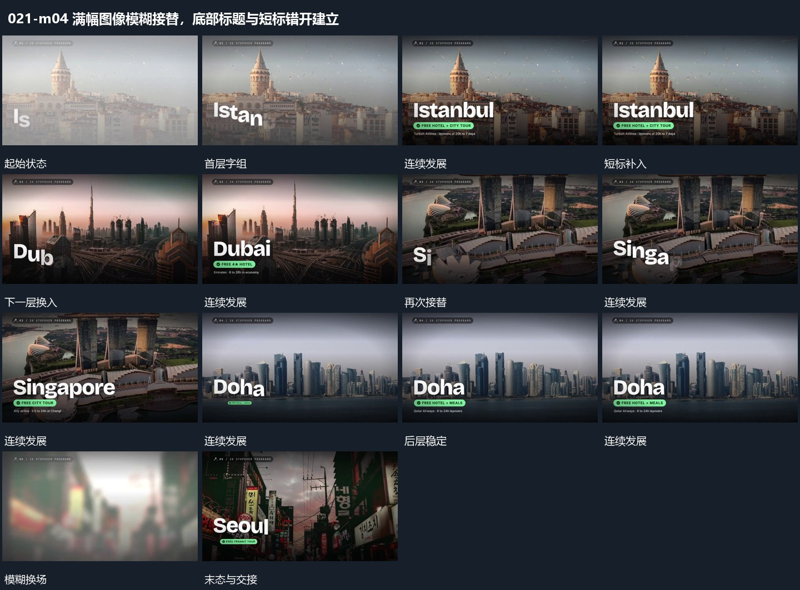

# 满幅图像模糊接替，底部标题与短标错开建立

## 运动指令

让当前全幅短暂模糊退去，下一层接上并恢复清楚；底部主字按词建立，短标随后补入。后段重复这组关系，保持各次画面可辨认的停留。

## 视频切片

[播放本机制的原片切片](m04.mp4)

覆盖分镜中“首层字组”至“模糊换场”的连续过程，并保留邻近的前后衔接画面；原片中交叠发生的动作一并保留。

## 分镜过程

## 组合与调整

不继承题材或原字幕，素材是否连续需新片另看，模糊只用于交接。
