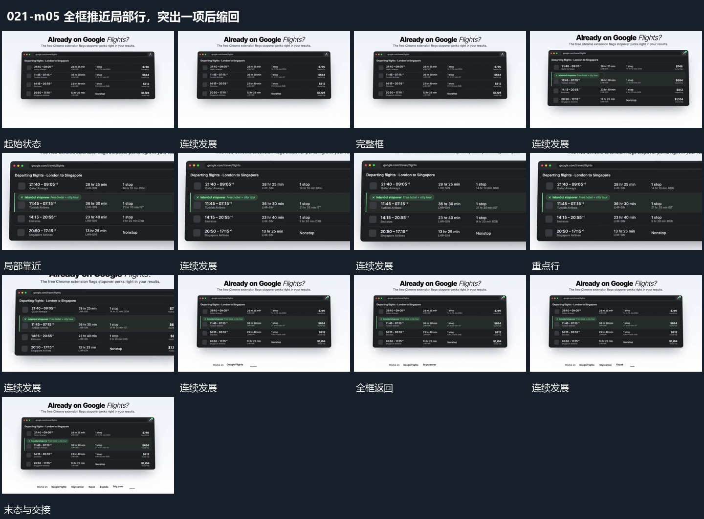

# 全框推近局部行，突出一项后缩回

## 运动指令

先显示完整窗口，再向其中一行靠近，强调范围在原行周围建立。局部内容更新后缩回到完整框，保留重点行的状态，与其他行共同可见。

## 视频切片

[播放本机制的原片切片](m05.mp4)

保留起始准备、连续发展和完成或明确交接；首尾按本段运动范围裁切，不拼接、不变速。尾部只保留理解结果所需的展示。

## 分镜过程

## 组合与调整

可改变重点行，保持原位置对应；推近时不能丢掉来源参照。
