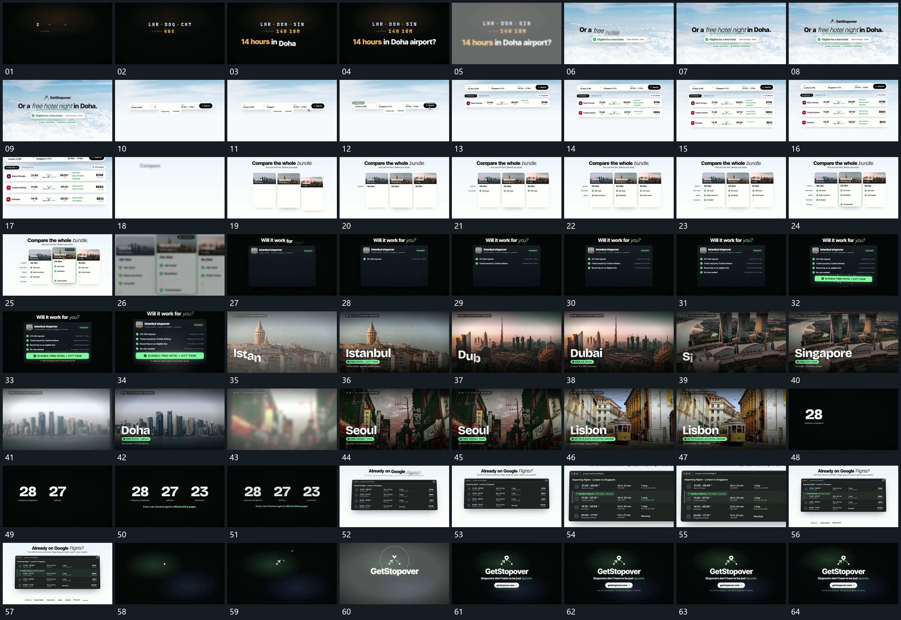

# 021｜原片运动总览

[观看完整原片](video.mp4)

## 运动总览

开头短字和数值逐项建立，亮闪后新底层接管。固定长条填字，下方短卡逐行补入 在固定长条里补齐内容，再向下增加横向短卡。竖卡并置后内部逐行累计，单卡边界突出 收成并置竖卡，内部按行累计，当前项获得边界强调。

随后 面板内完成点逐行出现，结果长条最后接入 在固定面板内逐行建立完成点与短文，末端结果长条接入。接 满幅图像模糊接替，底部标题与短标错开建立 用模糊过渡连续更换满幅图像，底部字组和短标分层建立。数值集合在后面逐项接入。

后段 全框推近局部行，突出一项后缩回 建立固定窗口，推近局部行并突出一项，再缩回完整框。尾部沿弧线移动的小形到达中央后，标记和字组接力完成。

## 完整运动段落

以下按原片中的出现顺序引用。建立、内部发展及完成反馈放在同一段中；同时发生的局部动作与运镜写在同一份指令里。不同段之间可以是连续接管，也可以是直接切换，不能仅凭条目相邻认定可直接拼接。重复出现的同类运动采用一次连续代表范围，切片不以逐段无缝覆盖整片为目标。

1. [固定长条填字，下方短卡逐行补入](mechanisms/m01.md)：上条保持，下方各行错开累积

2. [竖卡并置后内部逐行累计，单卡边界突出](mechanisms/m02.md)：各卡固定，内部增长，末段强调一项

3. [面板内完成点逐行出现，结果长条最后接入](mechanisms/m03.md)：顺序由上向下，已处理行保持

4. [满幅图像模糊接替，底部标题与短标错开建立](mechanisms/m04.md)：底层先接替，标题后显清，标记最后补入

5. [全框推近局部行，突出一项后缩回](mechanisms/m05.md)：外框提供参照，推近后重点范围局部更新

切片保留起始准备、必要内部停顿和完成或明确交接；首尾省略无新发展的等待，持续运动不要求人为停住。以上基于真实源帧序列和重点边界核对，不等同于全片连续声画审片。

## 完整64宫格

