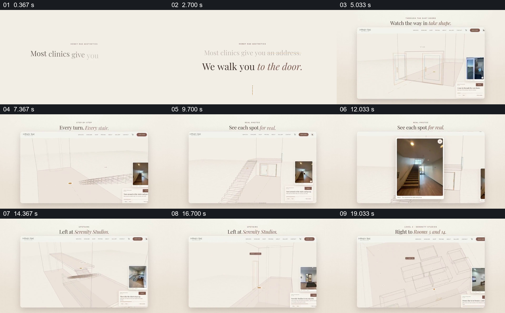

# 用线框行走路线配合实景照片指向房间

- 作品：案例 028《诊所室内路线指引》（索引名称）。
- 原片范围：00:00.000–00:21.000，含起点、不含终点；[完整原片](../video.mp4)｜[本卡片段](c01.mp4)。
- 观察方式：依据整片 64 宫格和约每秒一次的真实源帧观察，未连续原速观看或听审；声音、语气与完整播放节奏未确认。

## 原画面具体怎样设计

浅色画面先写“Most clinics give you an address. We walk you to the door.”；随后一个网页窗口中，细线构成入口、走廊与楼梯，橙色点标记当前位置，右侧保留对应实景照片和文字卡。楼梯照片被放大，路径继续经过左转、右转，最后形成多房间的俯视线框布局。

## 为什么这样设计，好在哪里

线框突出路线结构，照片帮助辨认现实位置；两者同时出现，使抽象转向和实际可见地标彼此对应。示意图本身不能证明建筑当前布局或无障碍通行条件。

以上为依据画面的分析，非作者自述；预期观看效果未经观众测试。

## 可直接使用的创意指令

当需要帮助首次到访者找到建筑内目标时，先实地核对入口、楼梯、电梯、转弯与目标房间，沿实际顺序制作清楚的路径示意；在每个关键节点配对应方向的实景照片，必要时允许放大查看。将无障碍路径和现场变化单独核实，图形风格可以按场所调整。
