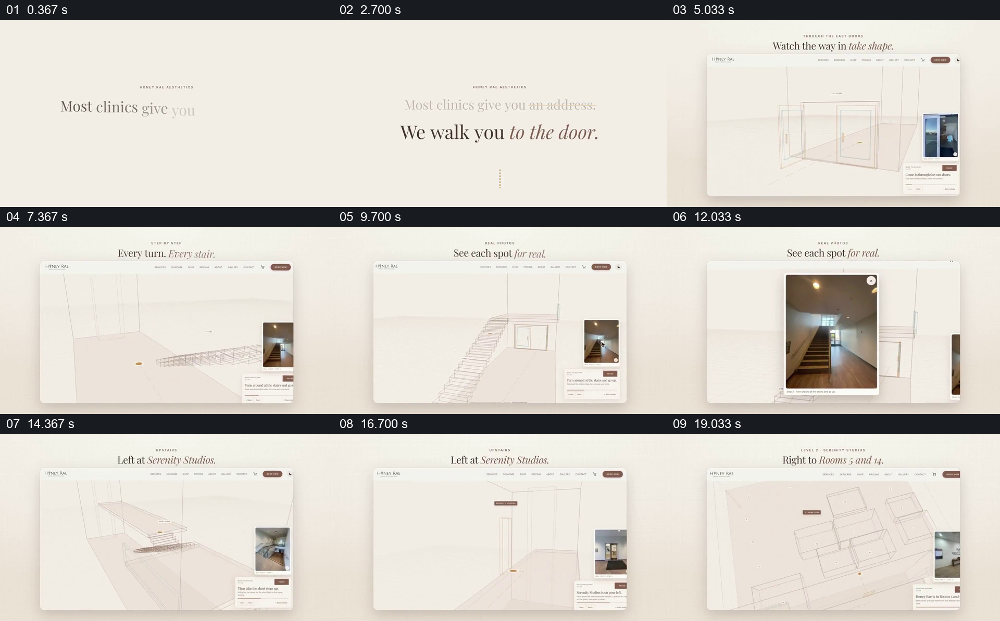

# 用空间线框串起入口到房间，并在关键位置展开实景照片

- 作品：案例 028《建筑照片与地图布局》（库内索引名称）。
- 原片范围：00:00.000–00:21.000，含起点、不含终点；[完整原片](../video.mp4)｜[本卡片段](c01.mp4)。
- 范围依据：从带路承诺与入口建立，覆盖楼梯、楼上转向和房间分布；随后进入品牌收尾。
- 观察方式与未确认范围：查看整片 64 帧总览和本卡分镜。未独立完成连续原速观看与听审；抽帧之间的运动、停顿与声音配合待复核。画面中的界面、数字与说明是作品呈现，未经额外核实；设计价值为基于画面的分析。

## 原画面具体怎样设计

米白背景中央先出现“多数诊所给你地址”，随后下一行强调“我们带你走到门口”。画面进入同色网页窗口，左侧大区域以纤细棕色线条组织门、墙和通道，地面有小圆点；右侧窄栏同时放置实景照片、地点步骤和方向文字。

入口之后的画面依次显示走廊和楼梯线框，右侧图片和指示也随地点改变。楼梯形成后，一张楼梯实景照片在窗口中间放大，后方仍能看见线框楼梯与周围空间：照片给出真实可辨认的现场，线框保留它在路线中的位置。

之后画面继续出现楼上走廊、左转位置和门口，线框最终展开为房间分布，右侧仍显示对应位置的照片和说明，顶部文字指出楼层与目标房间。抽帧能够确认这些先后状态，线框与视角之间的连续运动方式待原速复核。

## 为什么这样设计，好在哪里

开篇先把观众可能遇到的问题从“知道地址”收窄到“找到门”，后面的路径因而有清楚任务。大面积线框提供入口、楼梯、转弯与房间的关系，侧栏照片补足实景中能够辨认的细节；楼梯照片放大时并不完全取代背景，使局部实景仍与抽象路径有参照。

只给总平面难以辨别现场，只堆砌照片又不容易知道下一张在哪里；两者在相同节点上的对应，才让整套路线更容易被跟随。画面中的照片和地点是作品呈现，本次未实地核验。
