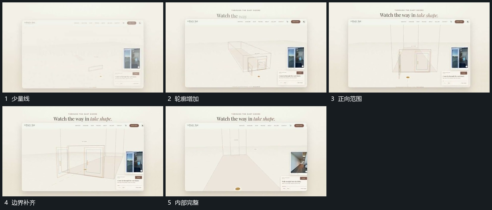

# 线段由少到多补成空间轮廓

## 运动指令

在固定窗口内逐段延长短线，组成较完整的空间边界，已有线保持。旁侧小片与上方字组留场，主结构由少到多显出。

## 视频切片

[播放本机制的原片切片](m01.mp4)

覆盖分镜中“少量线”至“内部完整”的连续过程，并保留邻近的前后衔接画面；原片中交叠发生的动作一并保留。

## 分镜过程

## 组合与调整

只借描线顺序，隐藏结构不猜测；线密度需保持可辨认。
