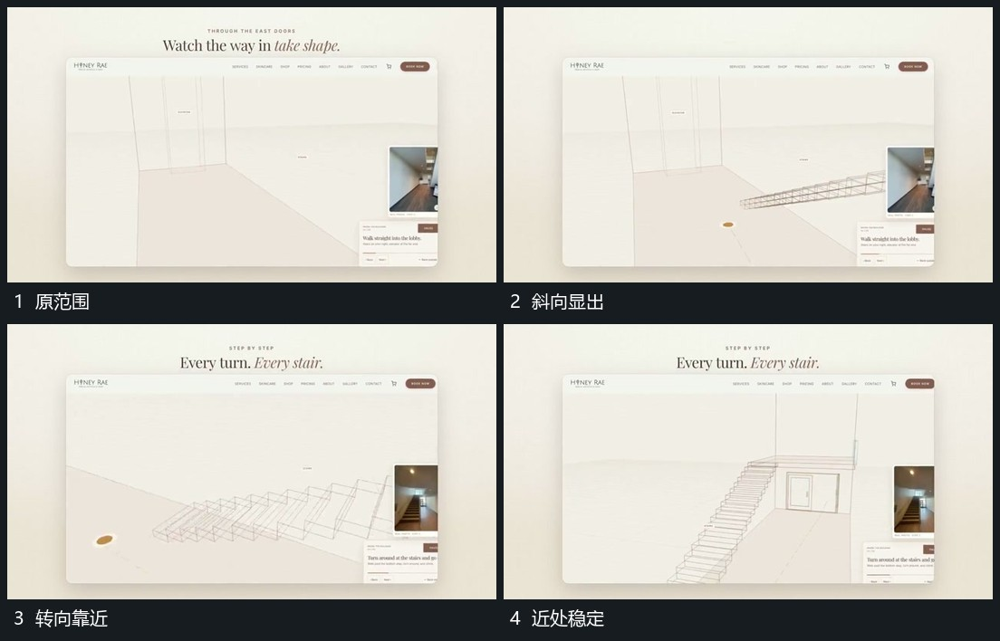

# 内部视角转向并沿纵深靠近，旁层固定

## 运动指令

保持窗口边界，内部观察方向转向较斜角度，再沿纵深靠近，原边界从两侧经过，新的近处范围显出。旁侧片保持相对位置并换入下一图。

## 视频切片

[播放本机制的原片切片](m02.mp4)

覆盖分镜中“原范围”至“近处稳定”的连续过程，并保留邻近的前后衔接画面；原片中交叠发生的动作一并保留。

## 分镜过程

## 组合与调整

新片需单独设计路径，不由帧序列认定原作者镜头或真实导航算法。
