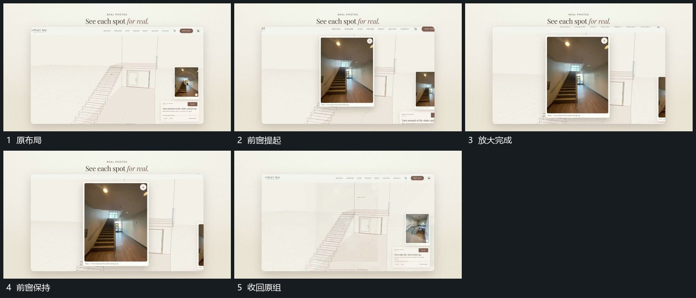

# 旁侧局部提成大窗，强调后收回

## 运动指令

从旁侧局部所在范围提起独立大窗，向中部放大，原轮廓仍在后层。局部展示完成后前窗收回，恢复原先窗口与旁片的共同布局。

## 视频切片

[播放本机制的原片切片](m03.mp4)

覆盖分镜中“原布局”至“收回原组”的连续过程，并保留邻近的前后衔接画面；原片中交叠发生的动作一并保留。

## 分镜过程

## 组合与调整

可用副本，保持来源锚点；前窗不应覆盖所有原空间直到无法对应。
