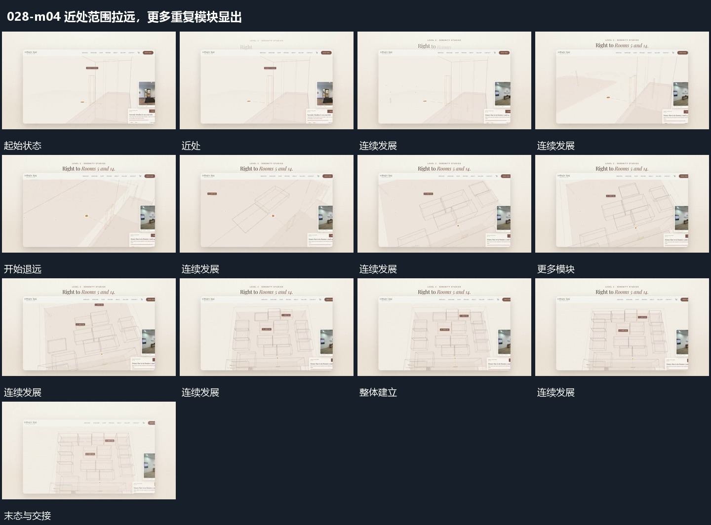

# 近处范围拉远，更多重复模块显出

## 运动指令

从近处沿观察方向退远，让更多重复模块依次进入视野，已有局部标签仍靠近原位置。整体建立后保持，再退出交给收尾字组。

## 视频切片

[播放本机制的原片切片](m04.mp4)

保留起始准备、连续发展和完成或明确交接；首尾按本段运动范围裁切，不拼接、不变速。尾部只保留理解结果所需的展示。

## 分镜过程

## 组合与调整

保留空间关系，不把拉远改成拼贴新增多个无来源模块。
