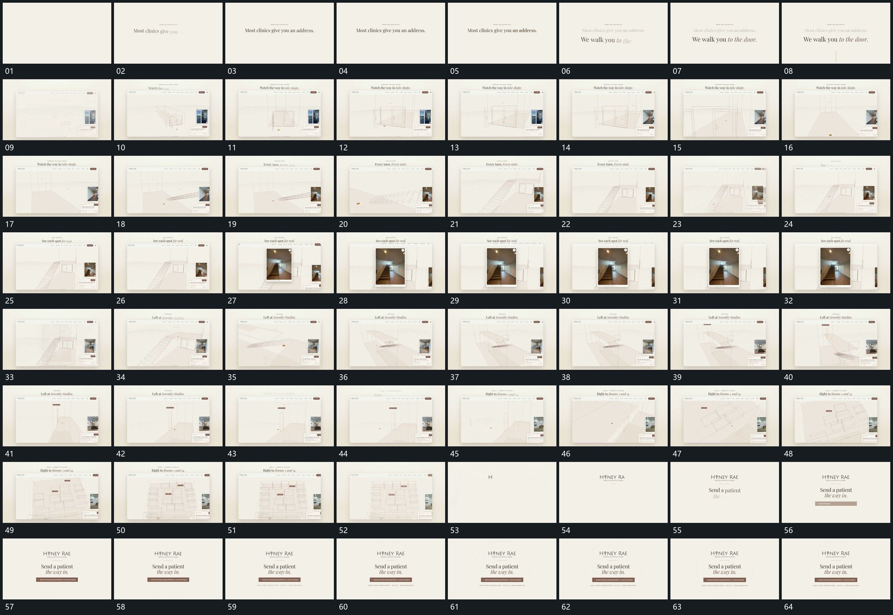

# 028｜原片运动总览

[观看完整原片](video.mp4)

## 运动总览

开头两行文字先后显出，旧行退弱，新行接续；虚线延长后完整窗口接入。线段由少到多补成空间轮廓 在窗口内从短线到空间轮廓逐步建立，旁侧小片留作参照。

随后 内部视角转向并沿纵深靠近，旁层固定 改变内部观察角度并向纵深推进，轮廓范围先在斜向视角中显出，再靠近其内部。中段 旁侧局部提成大窗，强调后收回 从旁侧小片所在范围提起较大图像窗，强调后收回，原轮廓仍在。

之后 内部视角转向并沿纵深靠近，旁层固定 再次沿空间路径转向与前进，旁侧内部画面接续更换。后段 近处范围拉远，更多重复模块显出 从近处拉远，更多重复模块显出，多个局部标记留在原位置。末尾整体退去，中心字组和长条接入。

## 完整运动段落

以下按原片中的出现顺序引用。建立、内部发展及完成反馈放在同一段中；同时发生的局部动作与运镜写在同一份指令里。不同段之间可以是连续接管，也可以是直接切换，不能仅凭条目相邻认定可直接拼接。重复出现的同类运动采用一次连续代表范围，切片不以逐段无缝覆盖整片为目标。

1. [线段补成空间轮廓，内部转向并沿纵深靠近](mechanisms/m05.md)：先由少量线段建立可辨空间，内部观看方向随后转动并沿纵深推进，旁侧参照层保持不动。

2. [旁侧局部提成大窗，强调后收回](mechanisms/m03.md)：原空间仍在，独立前窗负责局部重点

3. [近处范围拉远，更多重复模块显出](mechanisms/m04.md)：拉远扩大参照，各模块不独立飞入

切片保留起始准备、必要内部停顿和完成或明确交接；首尾省略无新发展的等待，持续运动不要求人为停住。以上基于真实源帧序列和重点边界核对，不等同于全片连续声画审片。

## 完整64宫格

