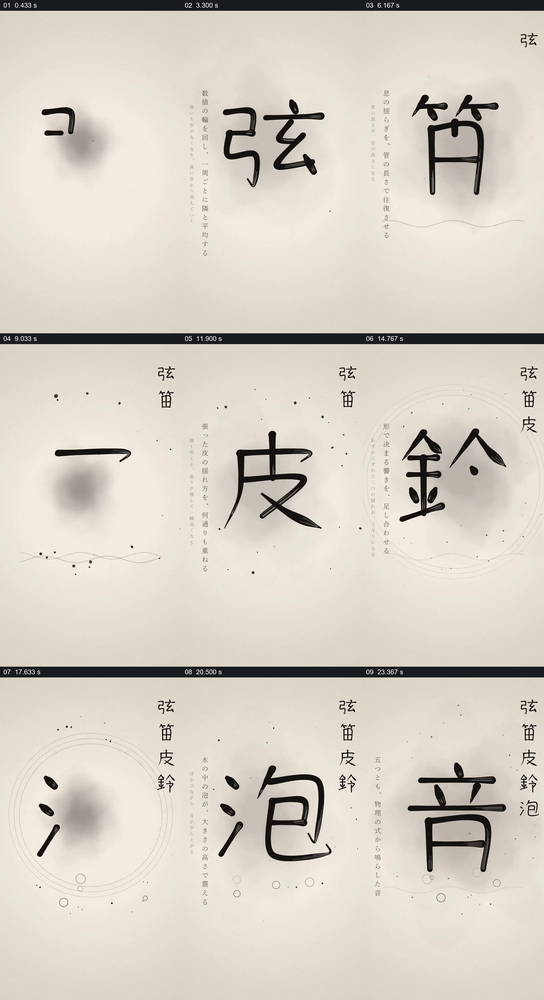

# 让单字书写逐个累积，最终汇聚到一个总字

- 作品：案例 081《汉字与音的连续展示》（本次概括）。
- 原片范围：00:00.000–00:25.792，含起点、不含终点；[完整原片](../video.mp4)｜[本卡片段](../video.mp4)。
- 观察方式：依据约每秒一次的真实源帧观察，未连续原速观看或听审；声音、语气与完整播放节奏未确认。

## 原画面具体怎样设计

竖向浅色纸面中央依次出现“弦”“笛”“皮”“铃”“泡”等大字，笔画在墨色晕染、细线或圆圈周围逐步形成；每个字完成后缩到右侧竖向列表，中央留给下一个字。左侧有细小的竖排文字，最后中央写成“音”，侧边仍保留先前字列并出现红色印章。

## 为什么这样设计，好在哪里

大字让每个字的形态成为阅读中心，缩到侧边后的字列保留了前面内容，使最后的“音”有可见的积累背景。文字含义及具体声音关联未经过听审。

以上为依据画面的分析，非作者自述；预期观看效果未经观众测试。

## 可直接使用的创意指令

用一组文字形成共同主题时，为每个词保留可读的主画面，随后将其移入持续可见的清单；在所有项建立后以一个总概念收束，并保留此前清单作为参照。选字及其关系须符合实际内容，笔画风格和布局可调整。
