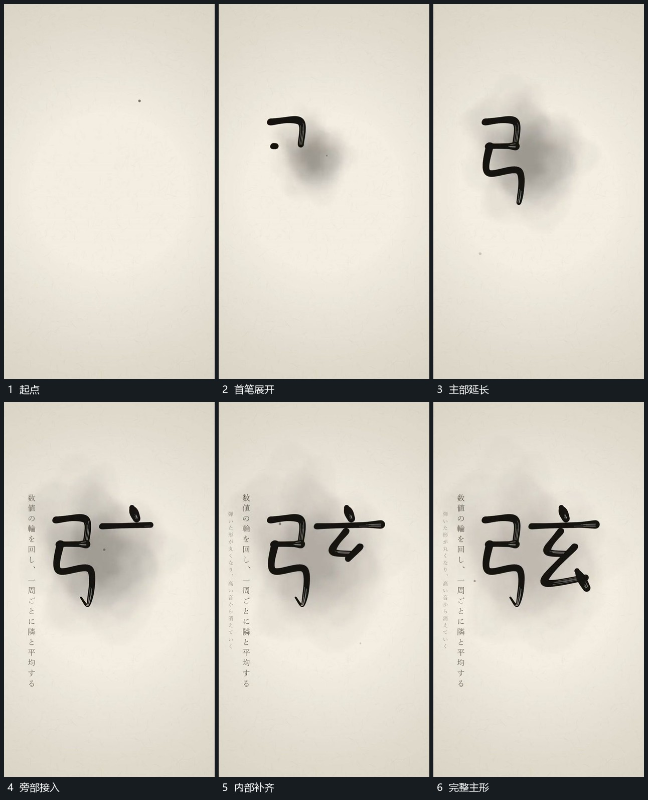

# 短笔段按路径累积成完整主形

## 运动指令

先在中央留下短段，从其端部沿折转路径逐步延长。一个部分完成后保持，再在旁侧补下一部分，最后补内部短段，使整体由零散路径累积成完整主形。旁侧小行可在主形接近完整时逐字建立。

## 视频切片

[播放本机制的原片切片](m01.mp4)

覆盖分镜中“起点”至“完整主形”的连续过程，并保留邻近的前后衔接画面；原片中交叠发生的动作一并保留。

## 分镜过程

## 组合与调整

路径可换任意轮廓；保留每段的起点与延伸方向，不用整体淡入替代描出过程。
