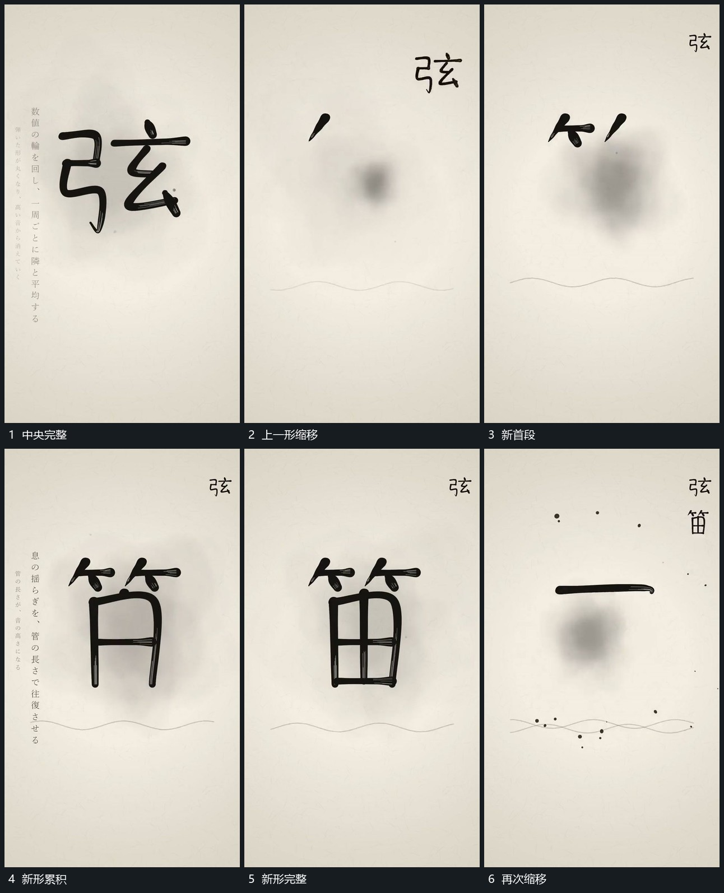

# 完成主形缩小移入侧列中央重新描入

## 运动指令

将完成主形整体缩小并移向侧上方，缩移中保留完整结构。到侧列后保持，中央从新短段开始重新描出下一形；每次完成后继续加入侧列，使旁列逐渐向下累积。

## 视频切片

[播放本机制的原片切片](m02.mp4)

覆盖分镜中“中央完整”至“再次缩移”的连续过程，并保留邻近的前后衔接画面；原片中交叠发生的动作一并保留。

## 分镜过程

## 组合与调整

侧列可以横排，核心是旧形有明确去处；新形不应等旧形完全消失后才另起。
