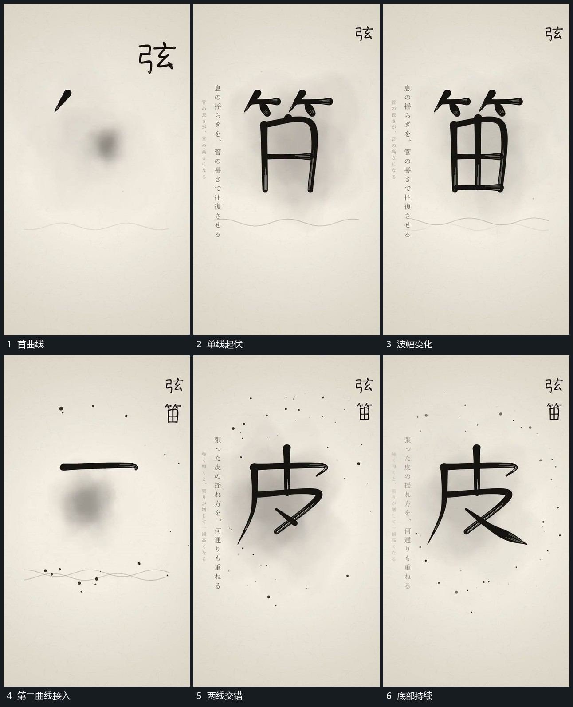

# 下方双曲线相位错开持续起伏

## 运动指令

在中央主形下方先建立横向曲线，只改变局部高低。随后加入第二条曲线，两者的起伏错开位置，时而相交、时而分离，两端仍留在同一范围。中央主形和侧列保持，底部变化不带动整组。

## 视频切片

[播放本机制的原片切片](m03.mp4)

覆盖分镜中“首曲线”至“底部持续”的连续过程，并保留邻近的前后衔接画面；原片中交叠发生的动作一并保留。

## 分镜过程

## 组合与调整

控制曲线数量与波幅；需要接下段时保留其中一条作为共同底部参照。
