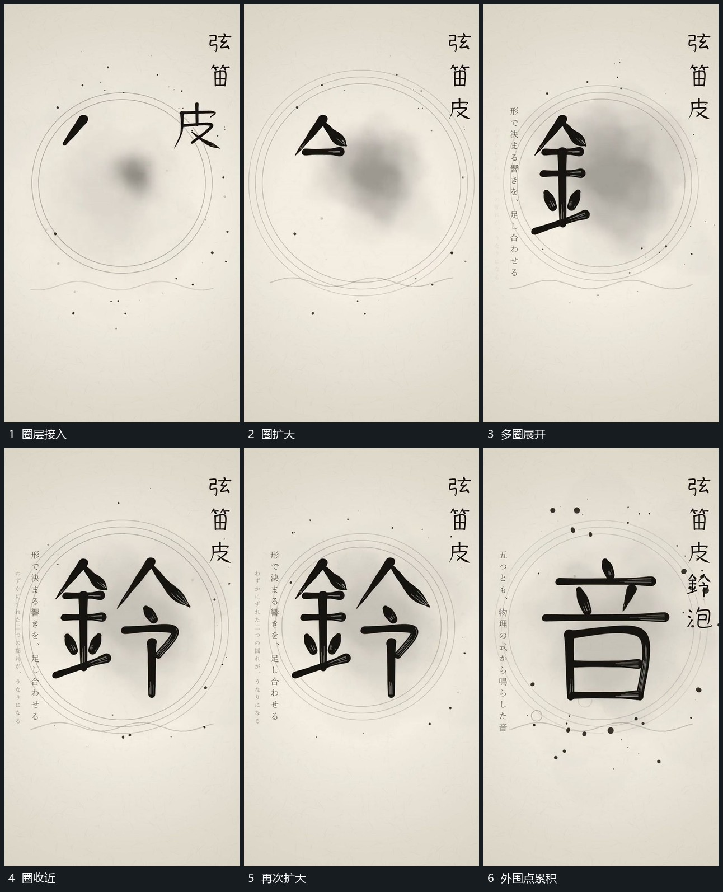

# 同心圈绕中央变化半径散点外围经过

## 运动指令

围中央建立多层圆圈，中心保持不动，各圈半径以不同幅度扩大和收近，避免所有圈同步变成一条粗边。小点在圈内外分次经过，中央主形继续逐段建立或保持，圈的变化不改变其比例。

## 视频切片

[播放本机制的原片切片](m04.mp4)

覆盖分镜中“圈层接入”至“外围点累积”的连续过程，并保留邻近的前后衔接画面；原片中交叠发生的动作一并保留。

## 分镜过程

## 组合与调整

可只用两圈；圈层是外围运动，不能让主形随每次扩张同步放大。
