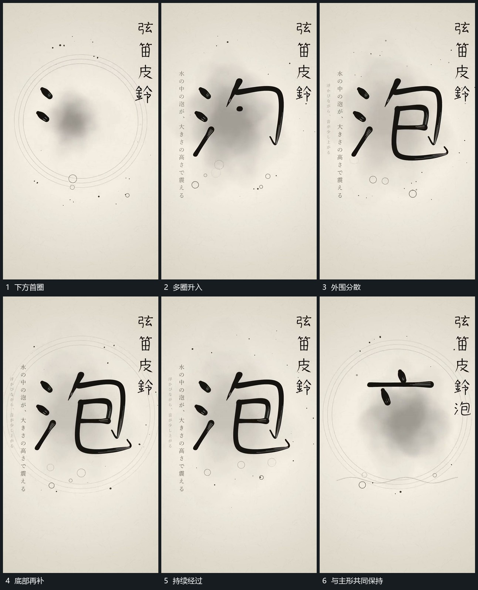

# 空心小圈从下方分次升入中央周边

## 运动指令

从下方曲线附近逐次建立小空心圈，小圈沿不同位置向上经过，大小和间距略有变化。上升时部分退弱，底部继续补入新的圈，中央主形与大圈始终保持各自范围。完成后减少新增，让剩余小圈退出。

## 视频切片

[播放本机制的原片切片](m05.mp4)

覆盖分镜中“下方首圈”至“与主形共同保持”的连续过程，并保留邻近的前后衔接画面；原片中交叠发生的动作一并保留。

## 分镜过程

## 组合与调整

可换成小片或点；起点保持在下方，避免所有小圈在全幅随机闪现。
