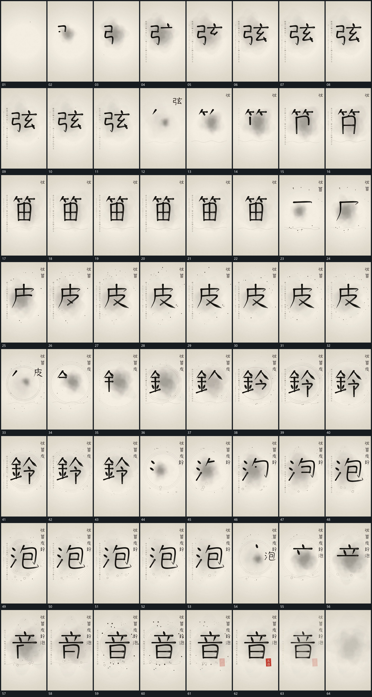

# 081｜原片运动总览

[观看完整原片](video.mp4)

## 运动总览

全片多次复用短笔段按路径累积成完整主形，从首段线形依次补成完整主形，再用完成主形缩小移入侧列中央重新描入把完成主形缩小并移到侧上方，留出中央给下一形。随阶段推进，下方双曲线相位错开持续起伏在下方建立两条起伏线并持续变化，同心圈绕中央变化半径散点外围经过补同心圈与外围散点。

后半段空心小圈从下方分次升入中央周边让空心小圈从下方分次升入，中央主形仍继续复用短笔段按路径累积成完整主形。最后侧列与中央完整主形共同保持，小标接入后整组退弱；静止阅读不单独增加机制。

## 完整运动段落

以下按原片中的出现顺序引用。建立、内部发展及完成反馈放在同一段中；同时发生的局部动作与运镜写在同一份指令里。不同段之间可以是连续接管，也可以是直接切换，不能仅凭条目相邻认定可直接拼接。重复出现的同类运动采用一次连续代表范围，切片不以逐段无缝覆盖整片为目标。

1. [笔段累积成形后缩入侧列，新形建立与下方双曲线交叠](mechanisms/m06.md)：中央短笔段沿路径累积成形，完成主形缩小进入侧列，新形在中央重新描入；下方双曲线相位错开持续起伏。

2. [中心新形逐项建立，圈线改变半径并接住上升小圈](mechanisms/m07.md)：中心形态继续分项建立，同心圈改变半径，外围散点经过；空心小圈从下方分次升入周边，共同完成围绕布局。

切片保留起始准备、必要内部停顿和完成或明确交接；首尾省略无新发展的等待，持续运动不要求人为停住。以上基于真实源帧序列和重点边界核对，不等同于全片连续声画审片。

## 完整64宫格

