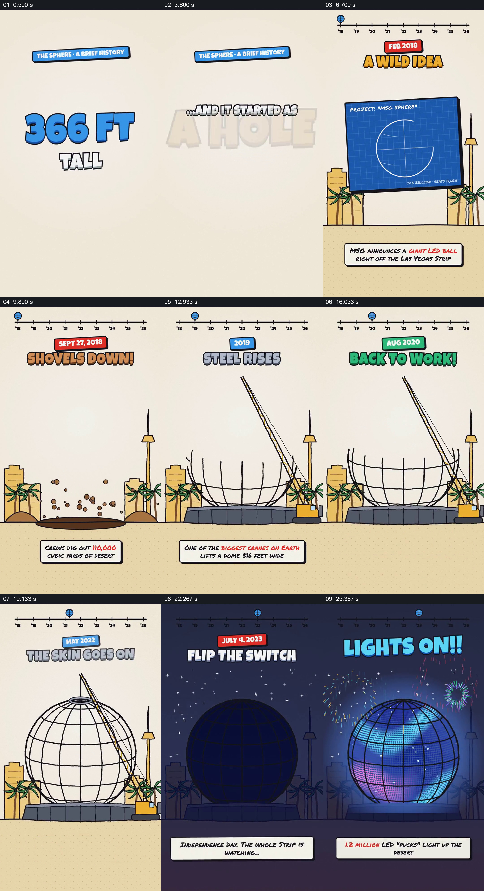

# 让球体沿时间线从草图长成并点亮

- 作品：案例 059《球形场馆的建设与演出》（索引名称）。
- 原片范围：00:00.000–00:28.000，含起点、不含终点；[完整原片](../video.mp4)｜[本卡片段](c01.mp4)。
- 观察方式：依据整片 64 宫格和约每秒一次的真实源帧观察，未连续原速观看或听审；声音、语气与完整播放节奏未确认。

## 原画面具体怎样设计

竖屏上先出现高度与灯数，顶部时间线建立；蓝图、地面挖坑和吊车相继出现，球形钢架逐渐长成，中途盖上暂停标记，复工后封顶并覆盖外壳。深色画面倒计时后球体亮起并显示眼睛图案。

## 为什么这样设计，好在哪里

同一球体持续变化，时间线给每次建设状态提供位置，暂停与复工成为过程的一部分。工程数字和日期未经核实。

以上为依据画面的分析，非作者自述；预期观看效果未经观众测试。

## 可直接使用的创意指令

讲述真实工程时，依据项目记录确定各阶段、日期和材料，用同一建筑示意保持状态连续；展示暂停、恢复及最终启用的真实条件，数据与照片应提供来源。
