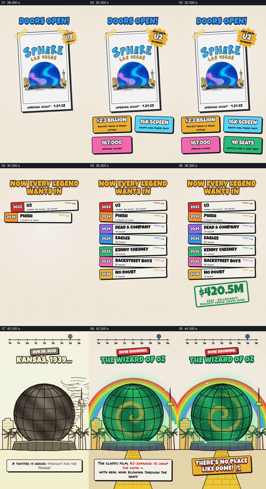

# 从开幕海报扩展到演出列表，再回到场馆外观

- 作品：案例 059《球形场馆的建设与演出》（索引名称）。
- 原片范围：00:28.000–00:46.000，含起点、不含终点；[完整原片](../video.mp4)｜[本卡片段](c02.mp4)。
- 观察方式：依据整片 64 宫格和约每秒一次的真实源帧观察，未连续原速观看或听审；声音、语气与完整播放节奏未确认。

## 原画面具体怎样设计

海报写球形场馆开幕，周围出现造价、屏幕和座位等彩色数据卡；接着多条按年份排列的演出名称依次增加。画面回到球体，外观由黑白转为彩色主题，并出现彩虹和道路。

## 为什么这样设计，好在哪里

先给一个具体开幕对象，再累积名单说明活动范围；回到球体让内容与场所重新对应。片中人名、日期和数字未核实。

以上为依据画面的分析，非作者自述；预期观看效果未经观众测试。

## 可直接使用的创意指令

介绍场所启用后的活动时，先展示可核实的开幕资料，再按时间列出代表性活动，并回到真实场所画面；人员、版权、统计和时间均应核对。
