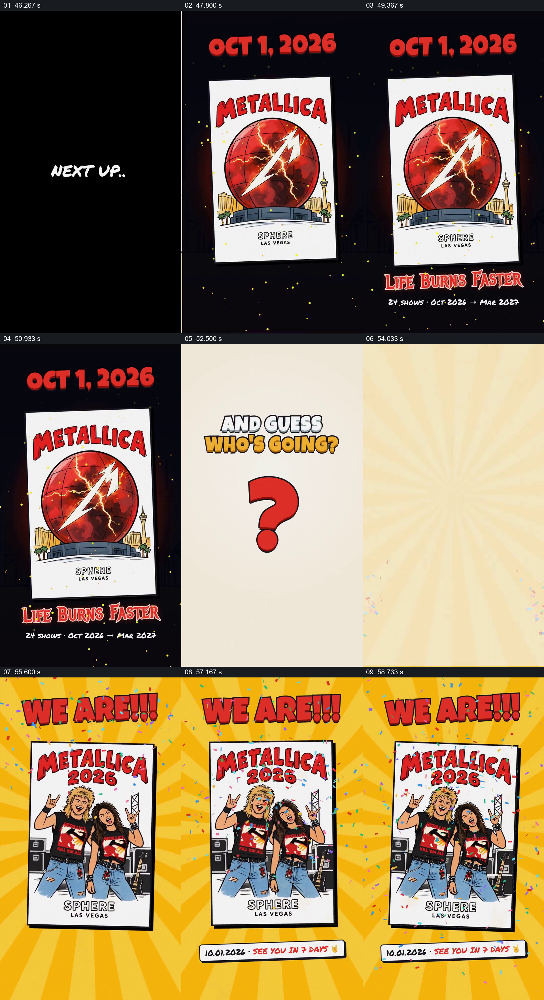

# 从即将发生的演出海报揭晓观看者

- 作品：案例 059《球形场馆的建设与演出》（索引名称）。
- 原片范围：00:46.000–01:00.032，含起点、不含终点；[完整原片](../video.mp4)｜[本卡片段](c03.mp4)。
- 观察方式：依据整片 64 宫格和约每秒一次的真实源帧观察，未连续原速观看或听审；声音、语气与完整播放节奏未确认。

## 原画面具体怎样设计

黑底出现日期与 Metallica 海报，随后画面提问“谁会去”；黄色放射背景中出现两位人物的演出海报，顶部写“WE ARE!!!”。

## 为什么这样设计，好在哪里

先建立具体活动，再用提问将注意转向参与者，人物出现完成回应。演出安排及人物身份未经独立核实。

以上为依据画面的分析，非作者自述；预期观看效果未经观众测试。

## 可直接使用的创意指令

当以参与者回应活动作结时，先给出真实活动及时间，再提出与参与相关的问题，用经授权的参与者形象回应；活动状态与身份需核实。
