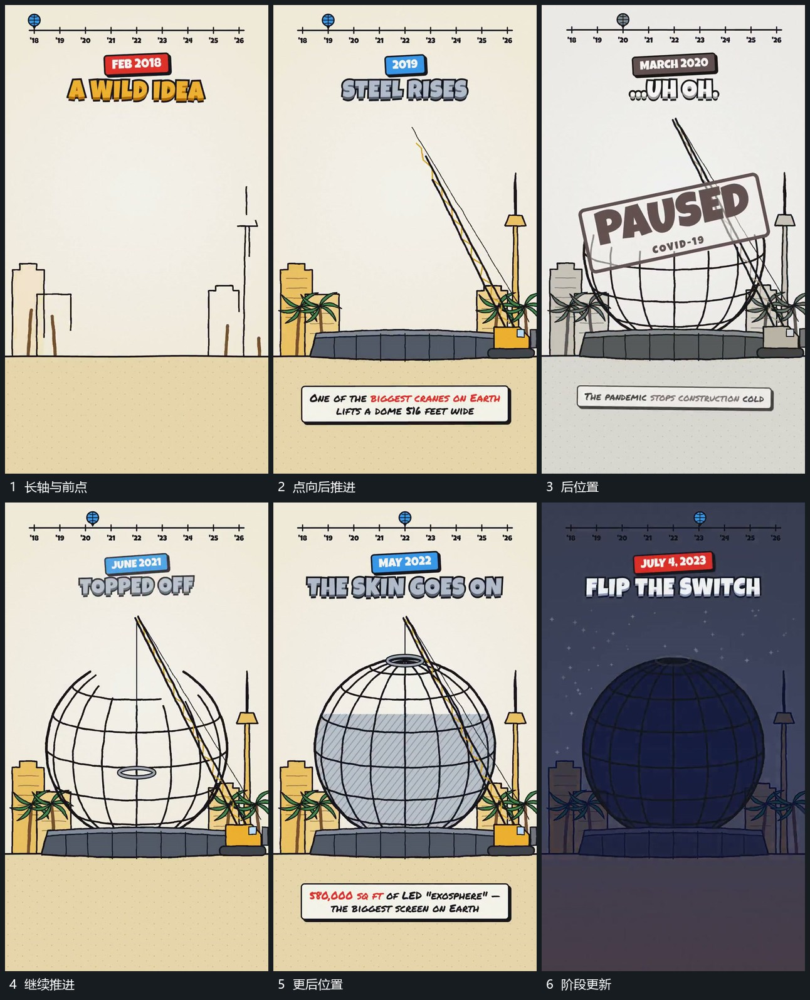

# 点沿固定长轴推进，旁侧短标原位接替

## 运动指令

保留顶端长轴，让小点沿轴从前向后推进。每到新的位置，旁侧短标与主字在原位接替，轴本身不重新入场，下面大组继续建立或更新。

## 视频切片

[播放本机制的原片切片](m01.mp4)

覆盖分镜中“长轴与前点”至“阶段更新”的连续过程，并保留邻近的前后衔接画面；原片中交叠发生的动作一并保留。

## 分镜过程

## 组合与调整

不继承原片年月，轴向位置可对应任何阶段。
