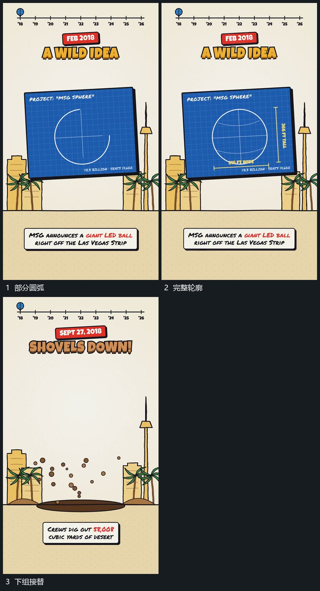

# 固定片内圆弧逐段补齐，交叉曲线与边缘标记后到

## 运动指令

在固定片内逐段补齐圆弧轮廓，再增加内部交叉曲线。边缘短线与标记最后延长，整片保持后交给下一组。

## 视频切片

[播放本机制的原片切片](m02.mp4)

覆盖分镜中“部分圆弧”至“下组接替”的连续过程，并保留邻近的前后衔接画面；原片中交叠发生的动作一并保留。

## 分镜过程

## 组合与调整

此段源帧只支持轮廓与内线的可见先后，精确描线轨迹仍需新片实现时确定。
