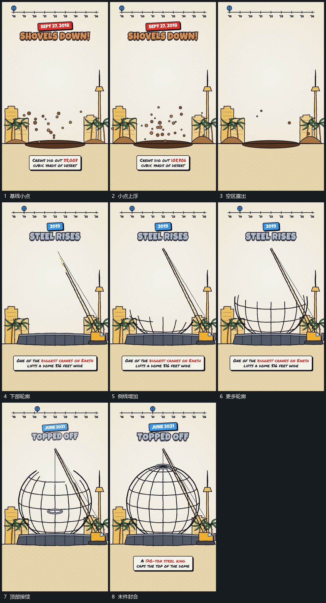

# 小点上浮退去，轮廓由下向上补齐，末端部件封合

## 运动指令

让基线附近小点向上浮起并退去，空出主要区域。新的轮廓从下部开始逐项建立，再向侧上方延伸，已有线保持，末端部件最后封合，形成完整组形。

## 视频切片

[播放本机制的原片切片](m03.mp4)

覆盖分镜中“基线小点”至“末件封合”的连续过程，并保留邻近的前后衔接画面；原片中交叠发生的动作一并保留。

## 分镜过程

## 组合与调整

按新片需要选择轮廓，不继承具体建筑或物体。顶端封合应等下部承载完整。
