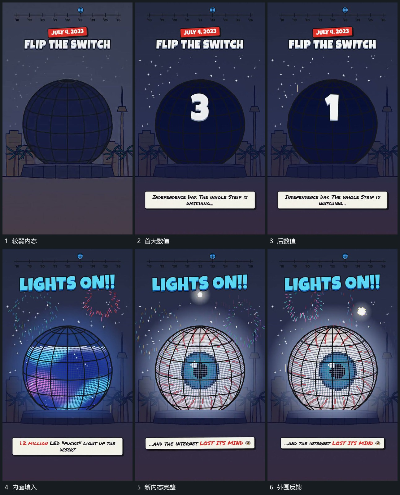

# 大数值递减，终点后内面逐段填入并追加扩散小点

## 运动指令

保留主轮廓，在内面建立大数值并逐次递减。到终点后大数值退出，新内面逐段填入，外围短点向外扩散，前景主字接替，轮廓边界保持。

## 视频切片

[播放本机制的原片切片](m04.mp4)

覆盖分镜中“较弱内态”至“外围反馈”的连续过程，并保留邻近的前后衔接画面；原片中交叠发生的动作一并保留。

## 分镜过程

## 组合与调整

不按原倒数数字规定时长。填面要接在数值终点之后。
