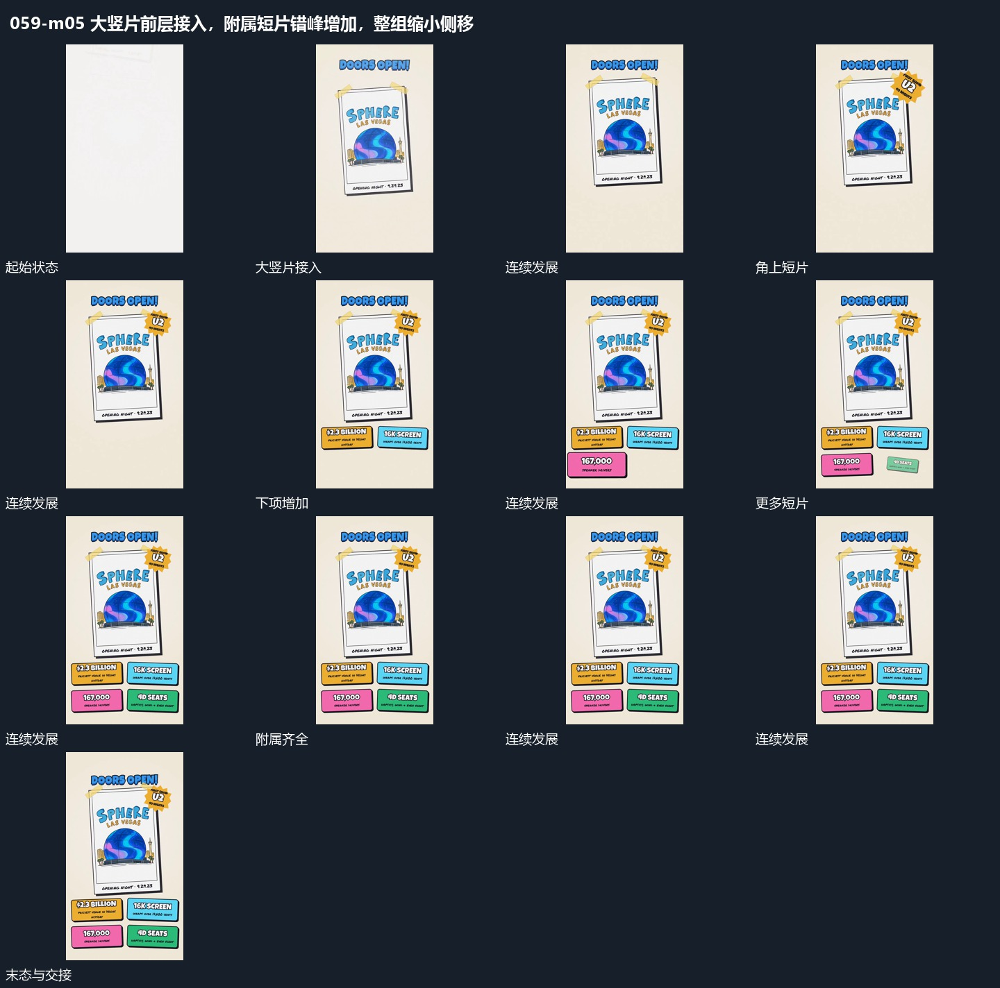

# 大竖片前层接入，附属短片错峰增加，整组缩小侧移

## 运动指令

在前层接入大竖片，片面完整后错开补入角上与下方短片。已有项保持，附属组齐全后将整组缩小并侧移，把主要空间让给新的纵列。

## 视频切片

[播放本机制的原片切片](m05.mp4)

覆盖分镜中“大竖片接入”至“整组缩移”的连续过程，并保留邻近的前后衔接画面；原片中交叠发生的动作一并保留。

## 分镜过程

## 组合与调整

附属位置可改变，缩移时各项作为同组保持相对关系。
