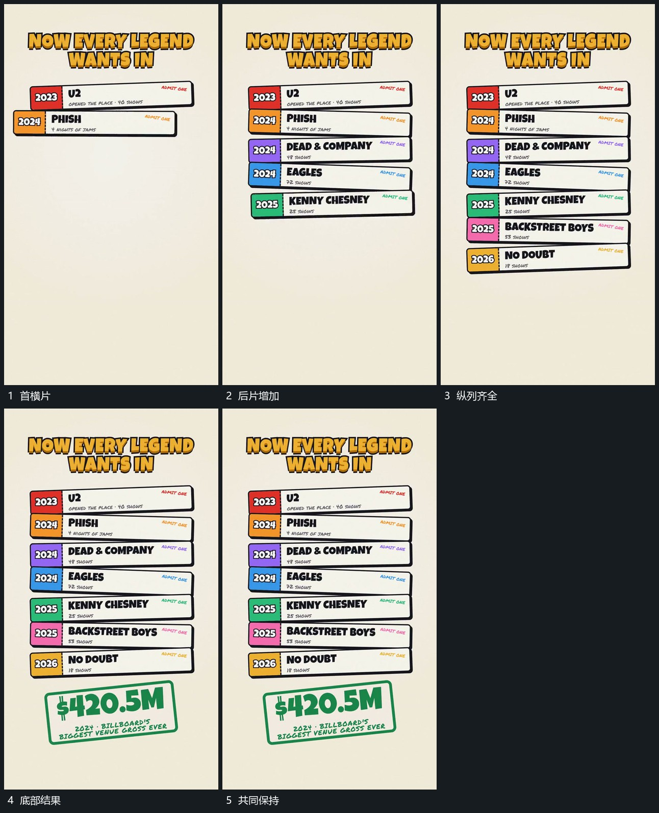

# 短横片从上到下累计成纵列，底部大反馈片最后加入

## 运动指令

先建立上方短横片，再依次向下补入后续横片，各片略错开但落稳后不动。完整纵列建立后在底部接入大反馈片，整组保持。

## 视频切片

[播放本机制的原片切片](m06.mp4)

覆盖分镜中“首横片”至“共同保持”的连续过程，并保留邻近的前后衔接画面；原片中交叠发生的动作一并保留。

## 分镜过程

## 组合与调整

不按原人名或年份命名。结果片须晚于纵列完成。
