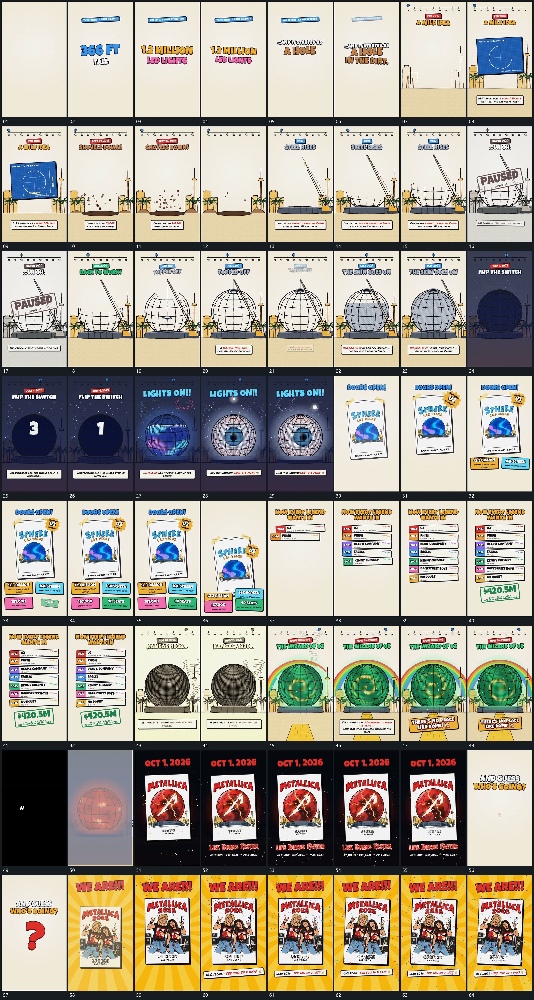

# 059｜原片运动总览

[观看完整原片](video.mp4)

## 运动总览

开头字组分段建立，顶端长轴接入。点沿固定长轴推进，旁侧短标原位接替 让点沿长轴推进，旁侧短标在原位更新，这一动作贯穿中段。固定片内圆弧逐段补齐，交叉曲线与边缘标记后到 在固定片内逐段补齐圆弧与交叉曲线，边缘短标随后延长。

中段 小点上浮退去，轮廓由下向上补齐，末端部件封合 从基线旁的小点上浮开始，再从下到上补出大轮廓，末端部件最后封合。局部大斜片短暂盖在轮廓前，退出后继续建立。大数值递减，终点后内面逐段填入并追加扩散小点 在较暗内态中递减大数值，终点后内面逐段填入，外围短点扩散。大竖片前层接入，附属短片错峰增加，整组缩小侧移 接入前层大竖片，四周短片错峰补齐，整体缩小侧移；短横片从上到下累计成纵列，底部大反馈片最后加入 从上到下增加短横片纵列，底部大反馈片最后接入。

后段轮廓内状态持续替换，旁侧弧线绕行，前层短片接替。末尾大竖片重复 大竖片前层接入，附属短片错峰增加，整组缩小侧移 的入场与附属增加，后层放射形建立，外围散片经过，最后保持。

## 完整运动段落

以下按原片中的出现顺序引用。建立、内部发展及完成反馈放在同一段中；同时发生的局部动作与运镜写在同一份指令里。不同段之间可以是连续接管，也可以是直接切换，不能仅凭条目相邻认定可直接拼接。重复出现的同类运动采用一次连续代表范围，切片不以逐段无缝覆盖整片为目标。

1. [沿轴推进建立位置，局部轮廓补齐后整体封合](mechanisms/m07.md)：沿轴推进提供持续参照，局部固定片先补弧线与交叉曲线；小点上浮退出后大轮廓从下往上补齐，顶端封合。

2. [大数值递减，终点后内面逐段填入并追加扩散小点](mechanisms/m04.md)：数值先落定，填面与反馈后到

3. [大竖片前层接入，附属短片错峰增加，整组缩小侧移](mechanisms/m05.md)：主片先稳，附属后到，再整体让位

4. [短横片从上到下累计成纵列，底部大反馈片最后加入](mechanisms/m06.md)：先逐项建立，后补结果

切片保留起始准备、必要内部停顿和完成或明确交接；首尾省略无新发展的等待，持续运动不要求人为停住。以上基于真实源帧序列和重点边界核对，不等同于全片连续声画审片。

## 完整64宫格

