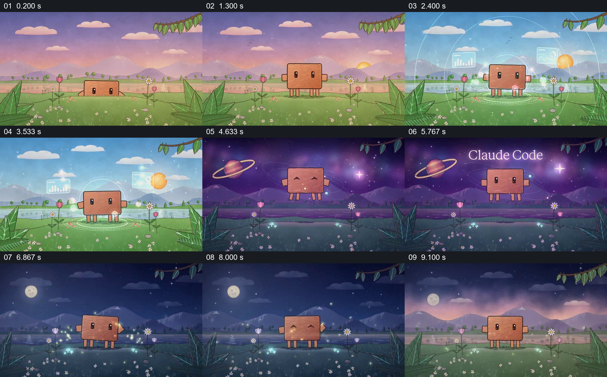

# 让固定角色经历同一草地中的环境变换

- 作品：案例 087《草地角色与昼夜变换》（本次概括）。
- 原片范围：00:00.000–00:10.048，含起点、不含终点；[完整原片](../video.mp4)｜[本卡片段](../video.mp4)。
- 观察方式：依据约每秒一次的真实源帧观察，未连续原速观看或听审；声音、语气与完整播放节奏未确认。

## 原画面具体怎样设计

花草与远山之间，小方块角色先从地平线附近升起；天空变亮，透明圆环与数据样式图形围绕角色，太阳出现在远处。画面随后转成紫色星空并出现 Claude Code 字样，角色下方出现光圈；夜色中月亮、发光花朵和光点保留，角色回到地面。

## 为什么这样设计，好在哪里

角色与草地保持可辨，让光照和天空变化集中承担气氛转变；由白天、宇宙到月夜的连续场景形成一段完整的形式体验。动作之间的连续性与声音未核实。

以上为依据画面的分析，非作者自述；预期观看效果未经观众测试。

## 可直接使用的创意指令

制作围绕角色的短视觉体验时，先建立可辨角色与空间，让环境元素在不同光照或背景中保留对应位置；用少量围绕角色的变化推动视觉发展，最后回到可辨的角色状态。角色、文字和环境依据实际主题适配。
