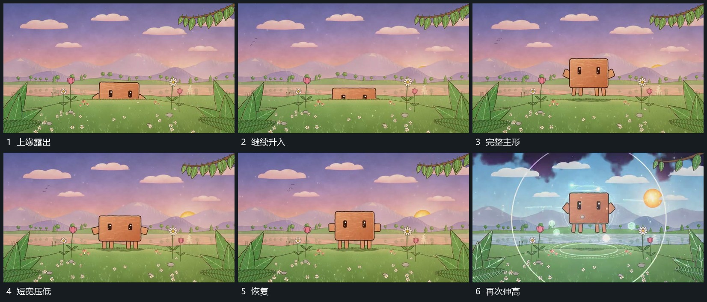

# 主形从下缘升入压低伸展后恢复

## 运动指令

让主形从下缘逐步升入，先露上部再露完整边界。升入后在同一底部范围压低并向两侧稍展，随后伸高、收窄并回到原比例；附属小部件随主体变化，不独立留在原处。

## 视频切片

[播放本机制的原片切片](m01.mp4)

覆盖分镜中“上缘露出”至“再次伸高”的连续过程，并保留邻近的前后衔接画面；原片中交叠发生的动作一并保留。

## 分镜过程

## 组合与调整

可循环复用，离场时沿下缘回落；起伏保留稳定底部参照。
