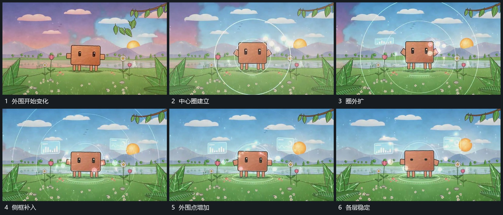

# 中心圈向外扩张侧框与外围点错开加入

## 运动指令

围主形建立小圈并向外扩张，后续圈层错开接上。侧面小框在圈扩大时分次加入，外围点再沿圈附近经过；中央主形始终留在原范围。完成后减少圈的扩张，保留各层局部活动。

## 视频切片

[播放本机制的原片切片](m02.mp4)

覆盖分镜中“外围开始变化”至“各层稳定”的连续过程，并保留邻近的前后衔接画面；原片中交叠发生的动作一并保留。

## 分镜过程

## 组合与调整

侧框可省略；圈与点的先后错开，不把所有外围层同步放大。
