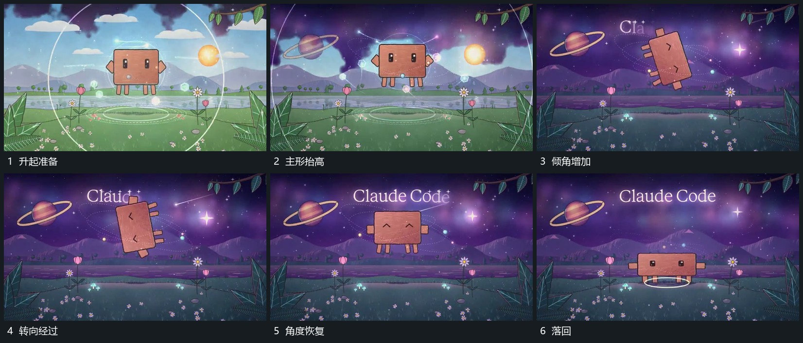

# 主形升起带倾角翻转再落回同一范围

## 运动指令

主形先向上抬起，底部留下椭圆圈参照。升高后带倾角转向，继续经过侧立状态，再收回转角并向原落点下降。落回时略压低，底部圈短暂扩张，随后恢复原比例。

## 视频切片

[播放本机制的原片切片](m03.mp4)

覆盖分镜中“升起准备”至“落回”的连续过程，并保留邻近的前后衔接画面；原片中交叠发生的动作一并保留。

## 分镜过程

## 组合与调整

保持同一落点；转向可减到较小角度，但抬起与回落仍形成完整过程。
