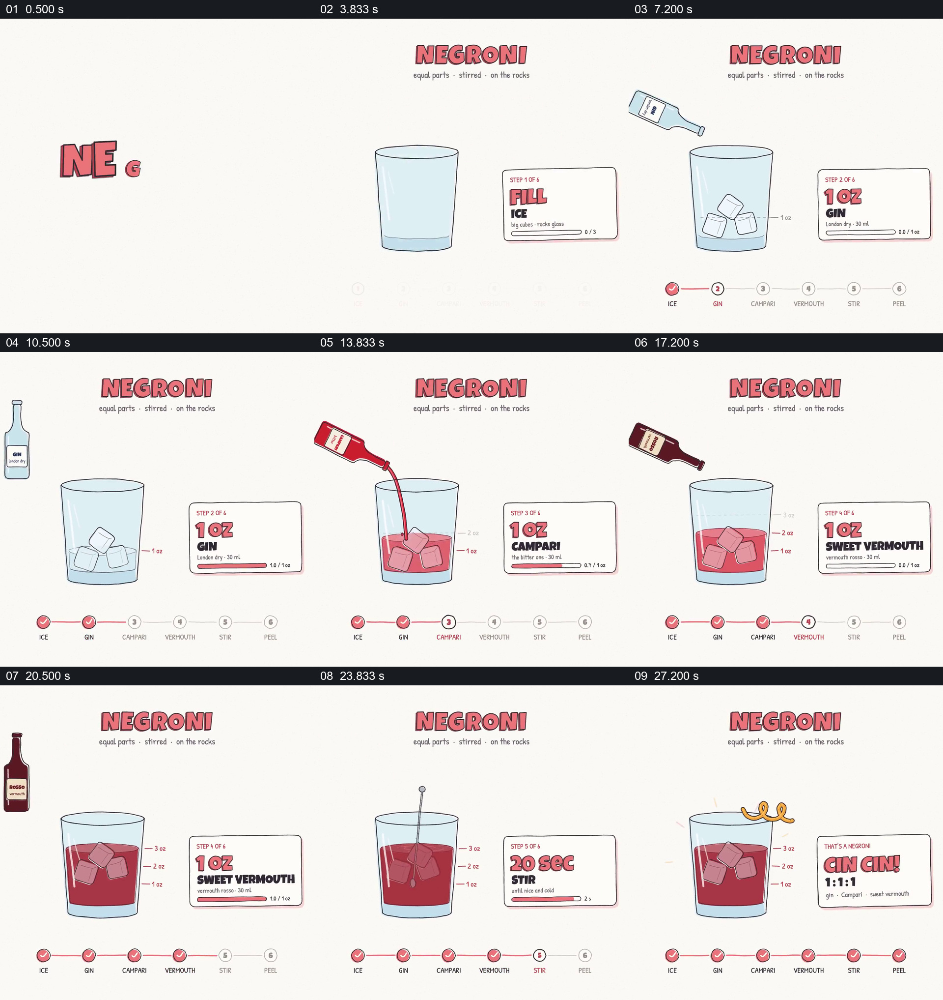

# 在固定杯子中逐项加入配料并累积步骤

- 作品：案例 060《鸡尾酒的逐步制作图解》（索引名称）。
- 原片范围：00:00.000–00:30.000，含起点、不含终点；[完整原片](../video.mp4)｜[本卡片段](../video.mp4)。
- 观察方式：依据整片 64 宫格和约每秒一次的真实源帧观察，未连续原速观看或听审；声音、语气与完整播放节奏未确认。

## 原画面具体怎样设计

白底中央画出玻璃杯，冰块进入；三种酒瓶依次从左上倒入，杯中液面升高并变红。右侧卡片显示每一步及用量，底部步骤节点逐个标记；最后搅拌、加入橙皮，显示比例总结。

## 为什么这样设计，好在哪里

固定杯子让每个步骤的结果累积而非重置，右侧用量与下方进度帮助对应动作。配方与实际容量未经核实。

以上为依据画面的分析，非作者自述；预期观看效果未经观众测试。

## 可直接使用的创意指令

展示一个按顺序制作的配方时，保持容器及已加入材料可见，逐项显示实际用量、动作和状态变化，完成后总结比例；具体配方和适用对象应按可靠资料确认。
