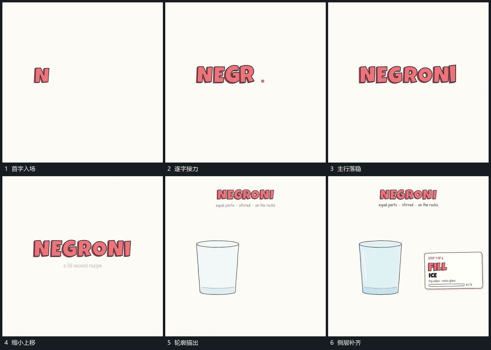

# 主字逐个放大落位，再上移让出下方轮廓

## 运动指令

让主字逐个放大出现并落到同一行，副行随后显出。字组完成后整体上移并缩小，为下方留出空间；下方轮廓分段描出，再补内部面片，右侧说明区域与底部节点连线接入。

## 视频切片

[播放本机制的原片切片](m01.mp4)

覆盖分镜中“首字入场”至“侧层补齐”的连续过程，并保留邻近的前后衔接画面；原片中交叠发生的动作一并保留。

## 分镜过程

## 组合与调整

可改字数和轮廓形状，保留字组先建立再让位的关系。下一机制应在轮廓能辨认承接范围之后进入，避免落下的块没有去处。
