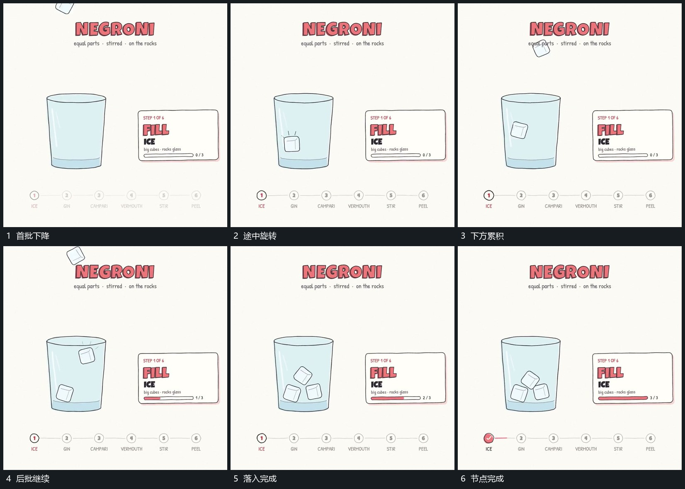

# 小块分批下降旋转，先到的在下方累积

## 运动指令

从上方分批放入小块，小块下落时带不同旋转，进入下方区域后保留。前批已在内部，后批仍在空中，让累积过程可见；旁侧进度线随阶段延长，全部落入后完成节点变实。

## 视频切片

[播放本机制的原片切片](m02.mp4)

覆盖分镜中“首批下降”至“节点完成”的连续过程，并保留邻近的前后衔接画面；原片中交叠发生的动作一并保留。

## 分镜过程

## 组合与调整

数量、旋转与下降距离可改，保留先到者不消失、后到者继续填入的关系。不由画面推断真实碰撞模拟；接下一机制时保留已经积下的小块。
