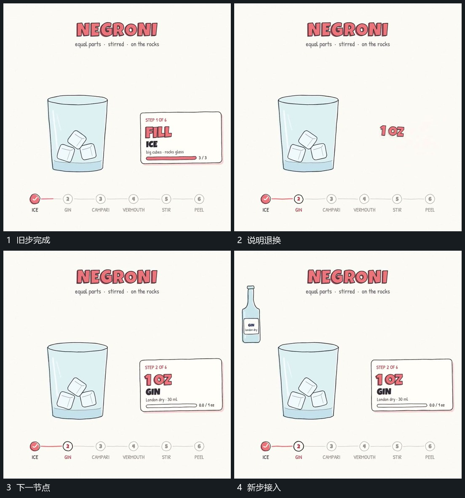

# 说明区域换内容，连接线向下一节点延长

## 运动指令

保留主区域及已经累积的内容，退去侧方旧内文，先建立新的主字，再补框和小字。底部连接线同时向下一节点延长，已完成节点保持，新动作从当前保留状态继续。

## 视频切片

[播放本机制的原片切片](m03.mp4)

覆盖分镜中“旧步完成”至“新步接入”的连续过程，并保留邻近的前后衔接画面；原片中交叠发生的动作一并保留。

## 分镜过程

## 组合与调整

可在多次操作之间复用，只更换需要变化的说明与活动节点。不要每换一步就清空主区域，否则前面累积失去作用。
