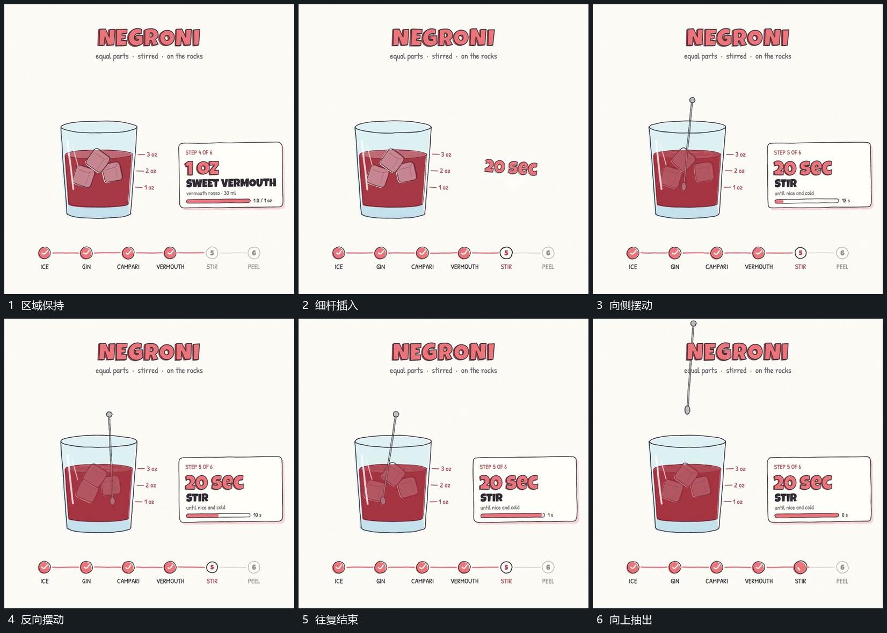

# 细杆向下插入，围绕下端摆动后抽出

## 运动指令

把细杆从上方插入已建立的区域，末端到位后围绕下部支点左右摆动，上端摆幅更明显。内部小块随之小幅变位，旁侧进度继续增长；往复完成后让细杆向上抽出，保留内部结果。

## 视频切片

[播放本机制的原片切片](m05.mp4)

覆盖分镜中“区域保持”至“向上抽出”的连续过程，并保留邻近的前后衔接画面；原片中交叠发生的动作一并保留。

## 分镜过程

## 组合与调整

可调摆幅与次数，必须区分整杆平移和围绕支点转动。退出应沿不会穿过边界的位置，下一动作在上方通道重新打开后接入。
