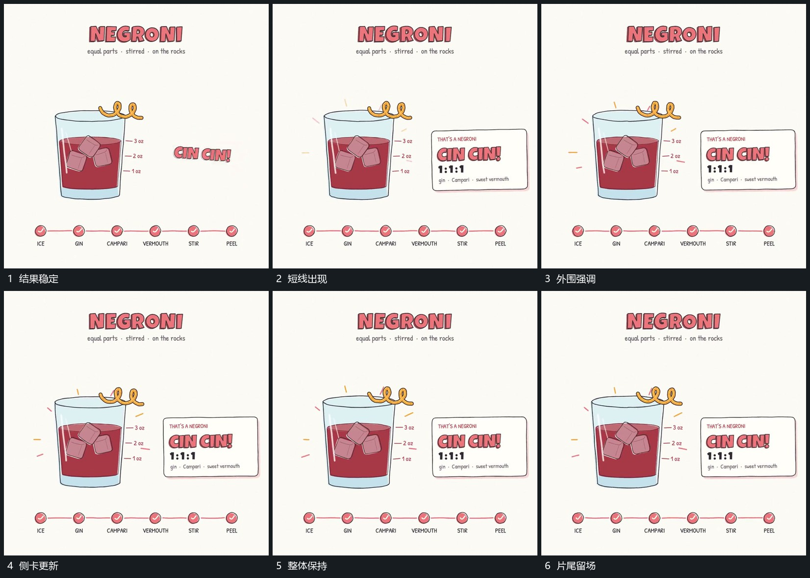

# 外围短线闪现，侧卡换成完成状态

## 运动指令

在主要结构稳定后，使外围短线短暂出现并退去，同时将侧卡更换为新的大字内容。大字建立后不再启动新的主运动，主结构、累积状态和节点线共同保持到尾部。

## 视频切片

[播放本机制的原片切片](m07.mp4)

覆盖分镜中“结果稳定”至“片尾留场”的连续过程，并保留邻近的前后衔接画面；原片中交叠发生的动作一并保留。

## 分镜过程

## 组合与调整

可减少短线或只保留侧卡更新。作为中段完成提示时，可从保留的主结构继续下一动作，不要求照搬片尾等待。
