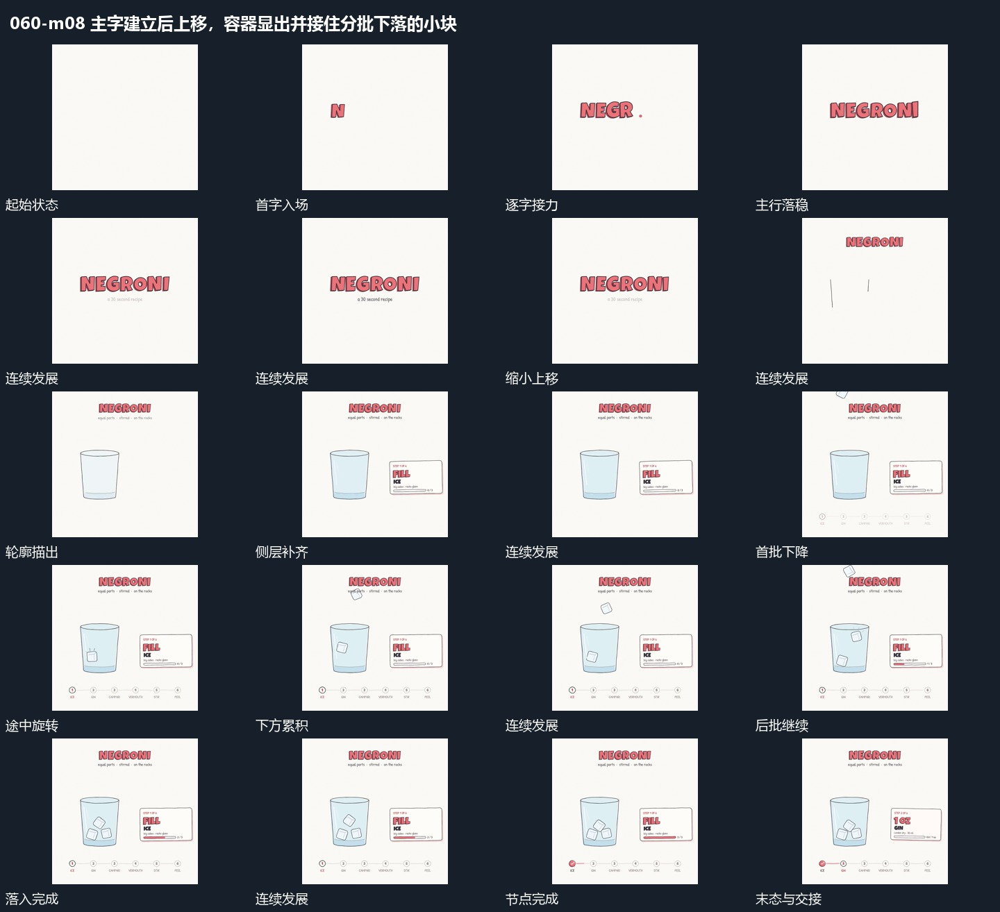

# 主字建立后上移，容器显出并接住分批下落的小块

## 运动指令

主字逐个放大落位后上移，下面轮廓与填充接入；小块分批下降旋转，先到者留在底部，形成累积结果。

1. **主字逐个放大落位，再上移让出下方轮廓**

让主字逐个放大出现并落到同一行，副行随后显出。字组完成后整体上移并缩小，为下方留出空间；下方轮廓分段描出，再补内部面片，右侧说明区域与底部节点连线接入。

2. **小块分批下降旋转，先到的在下方累积**

从上方分批放入小块，小块下落时带不同旋转，进入下方区域后保留。前批已在内部，后批仍在空中，让累积过程可见；旁侧进度线随阶段延长，全部落入后完成节点变实。

整段结束：多块落入后保留，旁侧进度增长到完成节点。 保留必要落稳与交接，中间已建立的参照沿用到下一步骤。

## 视频切片

[播放本机制的原片切片](m08.mp4)

保留起始准备、连续发展和完成或明确交接；首尾按本段运动范围裁切，不拼接、不变速。相连的小动作合为同一完整段落。

## 分镜过程

## 组合与调整

主字逐个放大落位后上移，下面轮廓与填充接入；小块分批下降旋转，先到者留在底部，形成累积结果。 复用时可调整元素数量、幅度和相对节奏，保留上述进入、交叠与完成关系；不直接沿用原片题材或时长。

可改字数和轮廓形状，保留字组先建立再让位的关系。下一机制应在轮廓能辨认承接范围之后进入，避免落下的块没有去处。

数量、旋转与下降距离可改，保留先到者不消失、后到者继续填入的关系。不由画面推断真实碰撞模拟；接下一机制时保留已经积下的小块。
