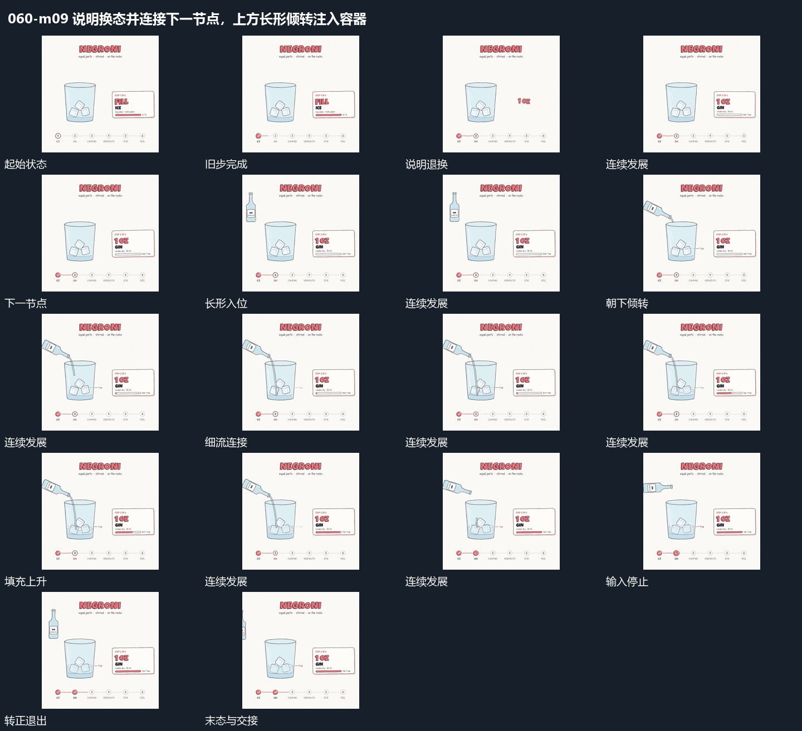

# 说明换态并连接下一节点，上方长形倾转注入容器

## 运动指令

侧说明换态时连接线向下一节点延伸，上方长形接入倾转；细流接到容器，内部填充持续上升直到停止。

1. **说明区域换内容，连接线向下一节点延长**

保留主区域及已经累积的内容，退去侧方旧内文，先建立新的主字，再补框和小字。底部连接线同时向下一节点延长，已完成节点保持，新动作从当前保留状态继续。

2. **上方长形倾转，细流连接后内部填充升高**

让长形从上方进入，转动到端部朝向下方承接区，再建立连接两者的细流。细流持续时，下方内部填充逐渐升高，已有小块与先前填充保留；达到这一轮终点后先停止细流，再让上方长形转正、向上退出。后续换一个输入形仍从已增加的高度继续。

整段结束：细流停止，长形转正退出，内部填充保持增加后的高度。 保留必要落稳与交接，中间已建立的参照沿用到下一步骤。

## 视频切片

[播放本机制的原片切片](m09.mp4)

保留起始准备、连续发展和完成或明确交接；首尾按本段运动范围裁切，不拼接、不变速。相连的小动作合为同一完整段落。

## 分镜过程

## 组合与调整

侧说明换态时连接线向下一节点延伸，上方长形接入倾转；细流接到容器，内部填充持续上升直到停止。 复用时可调整元素数量、幅度和相对节奏，保留上述进入、交叠与完成关系；不直接沿用原片题材或时长。

可在多次操作之间复用，只更换需要变化的说明与活动节点。不要每换一步就清空主区域，否则前面累积失去作用。

可以替换输入形和承接边界，核心是输入期间累计、退出后结果保留。原片重复多轮同一关系，复用此机制即可，不按每轮另建卡。
