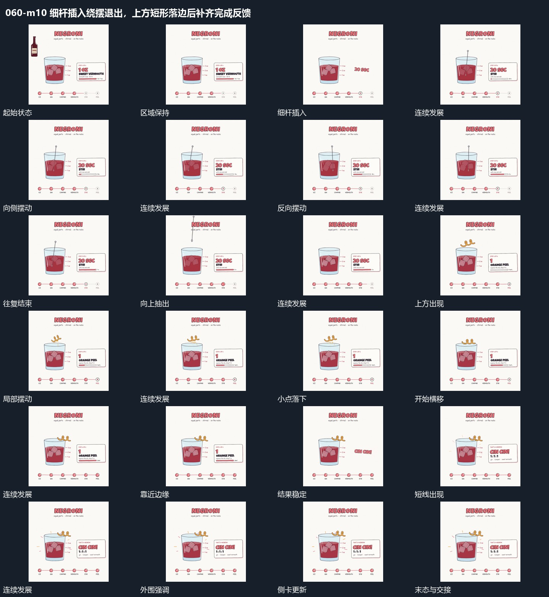

# 细杆插入绕摆退出，上方短形落边后补齐完成反馈

## 运动指令

细杆先进入并围绕下端摆动，再抽出；上方短形摆动后横移到边缘落位，外围短线与侧卡完成最后反馈。

1. **细杆向下插入，围绕下端摆动后抽出**

把细杆从上方插入已建立的区域，末端到位后围绕下部支点左右摆动，上端摆幅更明显。内部小块随之小幅变位，旁侧进度继续增长；往复完成后让细杆向上抽出，保留内部结果。

2. **上方短形先摆动，再横移到边缘落位**

让短形先在主区域上方小幅摆动和转动，下方有小点落下。局部动作结束后，再向右横移并落在上边缘位置；主区域保持原位与已有内部状态，短形归位后共同停稳。

3. **外围短线闪现，侧卡换成完成状态**

在主要结构稳定后，使外围短线短暂出现并退去，同时将侧卡更换为新的大字内容。大字建立后不再启动新的主运动，主结构、累积状态和节点线共同保持到尾部。

整段结束：外围短线退去，侧卡新大字完整，主结构继续留场。 保留必要落稳与交接，中间已建立的参照沿用到下一步骤。

## 视频切片

[播放本机制的原片切片](m10.mp4)

保留起始准备、连续发展和完成或明确交接；首尾按本段运动范围裁切，不拼接、不变速。相连的小动作合为同一完整段落。

## 分镜过程

## 组合与调整

细杆先进入并围绕下端摆动，再抽出；上方短形摆动后横移到边缘落位，外围短线与侧卡完成最后反馈。 复用时可调整元素数量、幅度和相对节奏，保留上述进入、交叠与完成关系；不直接沿用原片题材或时长。

可调摆幅与次数，必须区分整杆平移和围绕支点转动。退出应沿不会穿过边界的位置，下一动作在上方通道重新打开后接入。

可改变归位侧边，需预留能承接它的位置。不要把短形从上方直接切到边缘，横移过程负责说明两处是同一活动元素。

可减少短线或只保留侧卡更新。作为中段完成提示时，可从保留的主结构继续下一动作，不要求照搬片尾等待。
