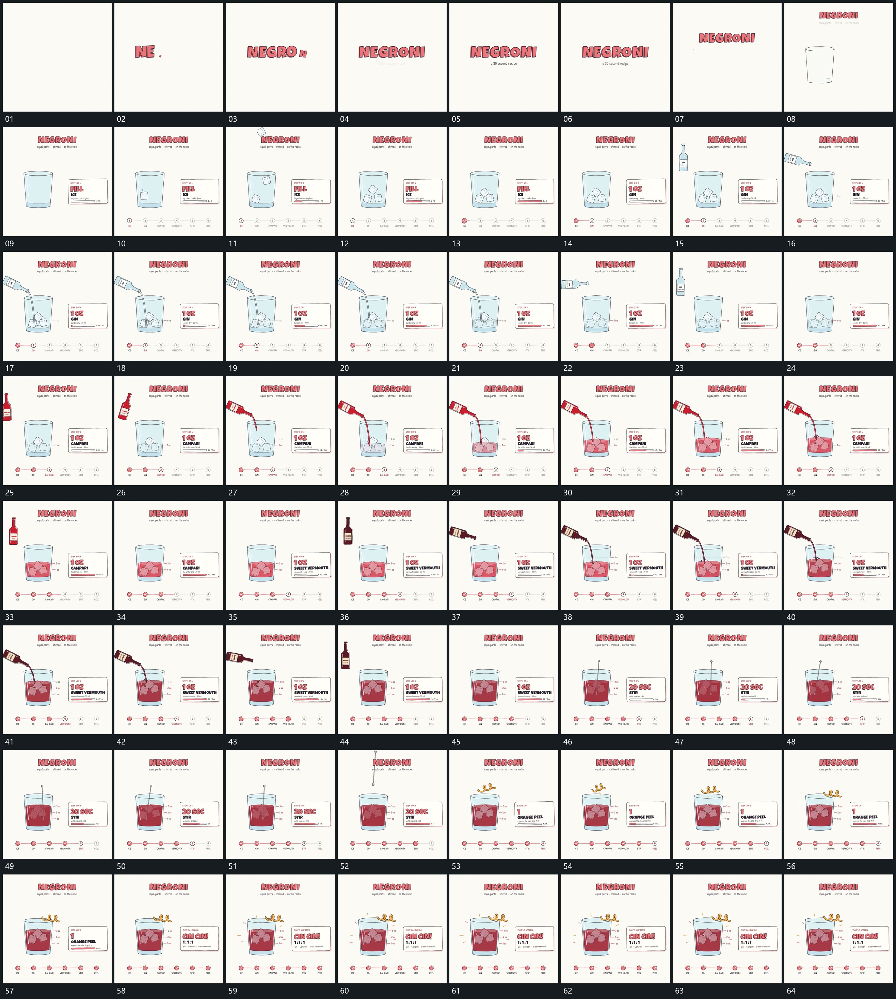

# 060｜原片运动总览

[观看完整原片](video.mp4)

## 运动总览

开头 主字逐个放大落位，再上移让出下方轮廓 让文字逐字落位，再缩小上移，描出下方轮廓并建立侧方说明与底部节点。小块分批下降旋转，先到的在下方累积 分批落入旋转小块，内部累积，进度与完成节点响应。

每轮操作之间复用 说明区域换内容，连接线向下一节点延长：主区域不清空，只更换侧方说明并把连线接到下一节点。随后 上方长形倾转，细流连接后内部填充升高 让上方长形倾转、建立细流、内部填充升高，再停流、转正、退出。这段在中部多次重复，输入形更换，但下方沿用前一轮的结果继续增长。

之后 细杆向下插入，围绕下端摆动后抽出 将细杆插入，围绕下端往复摆动再抽出。上方短形先摆动，再横移到边缘落位 让上方短形先局部动作，再横移到边缘落位。末段 外围短线闪现，侧卡换成完成状态 给出短促外围反馈，侧卡更新，整组保留完成状态收尾。

## 完整运动段落

以下按原片中的出现顺序引用。建立、内部发展及完成反馈放在同一段中；同时发生的局部动作与运镜写在同一份指令里。不同段之间可以是连续接管，也可以是直接切换，不能仅凭条目相邻认定可直接拼接。重复出现的同类运动采用一次连续代表范围，切片不以逐段无缝覆盖整片为目标。

1. [主字建立后上移，容器显出并接住分批下落的小块](mechanisms/m08.md)：主字逐个放大落位后上移，下面轮廓与填充接入；小块分批下降旋转，先到者留在底部，形成累积结果。

2. [说明换态并连接下一节点，上方长形倾转注入容器](mechanisms/m09.md)：侧说明换态时连接线向下一节点延伸，上方长形接入倾转；细流接到容器，内部填充持续上升直到停止。

3. [细杆插入绕摆退出，上方短形落边后补齐完成反馈](mechanisms/m10.md)：细杆先进入并围绕下端摆动，再抽出；上方短形摆动后横移到边缘落位，外围短线与侧卡完成最后反馈。

切片保留起始准备、必要内部停顿和完成或明确交接；首尾省略无新发展的等待，持续运动不要求人为停住。以上基于真实源帧序列和重点边界核对，不等同于全片连续声画审片。

## 完整64宫格

