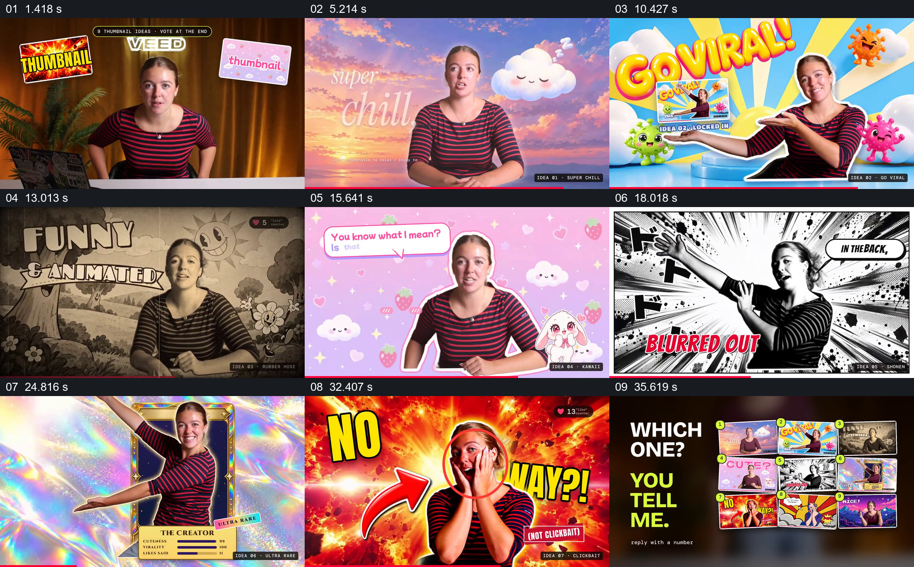
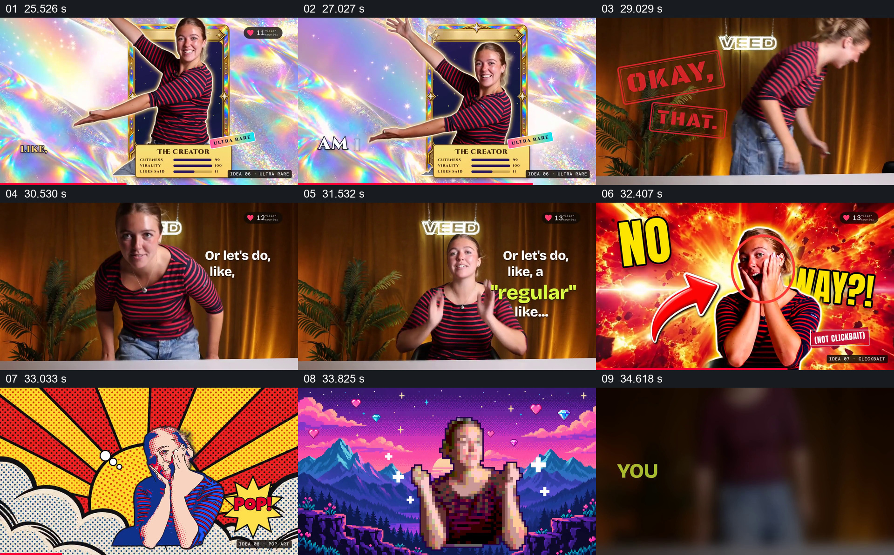

# 让同一人物进入九种封面，再把方案并排交给观众选择

- 作品：案例 001《人物口播、剪影与插画背景》（索引名称）。
- 原片范围：00:00.000–00:37.248，含起点、不含终点；[完整原片及本卡片段](../video.mp4)。本卡覆盖整片，直接共用原文件。
- 观察方式：按原片 64 宫格顺序查看全片，并从原片抽取下方两组带源时间的真实帧，结合原运动总览核对过程；未进行连续原速声画观看或听审，声音内容与语气尚未确认。音、视频流均可完整解码。

补充分镜源时间依次为 25526、27027、29029、30530、31532、32407、33033、33825、34618 毫秒。

## 原画面具体怎样设计

人物进入桌前的真实拍摄环境，周围出现不同缩略图小卡，画面上方提示有九种封面想法、结尾投票。搜索条与人物旁的短句接入后，第一种方案把人物放在晚霞与睡云前，写上“super chill”。

随后同一人物进入不同处理的全屏画面：明亮放射背景与“GO VIRAL”大字中，人物张开双臂并托住一张成品缩略图；复古黑白插画中，人物与树、花和“FUNNY & ANIMATED”共同入画；粉色云朵、草莓与对话框形成另一种风格；黑白漫画放射线和对白气泡则配合人物伸手动作。人物或局部轮廓继续占据显著位置，样式标签标出当前方案。

中段画面回到桌前，人物站起并再次伸展手臂，接入彩色闪光的收藏卡画面：卡框在身后，手臂越过卡框，底部有标题和属性条。再次回到桌前后，人物捧脸的姿势依次被放进爆炸式夸张封面、波普插画和像素风景。最后画面把九种结果缩成编号小图，排成网格，旁边出现“WHICH ONE? YOU TELL ME.”，请观众按编号回应。

## 为什么这样设计，好在哪里

九种处理不是只用文字列出风格名称：每次都把同一位人物放进实际示例，背景、字形和人物轮廓一起变化，因此可以直接看见同一主体在不同方案中的差别。人物的手势、姿态和持续的外形识别，把变化较大的画面串成一组；托举缩略图和越出卡框也让人物参与展示，而不只是被贴在背景上。

末尾将分散出现的结果重新并列并编号，使观看者不必完全凭记忆比较，选择提示也有明确对象。这是基于画面的设计分析，不代表作者自述，也不代表已测量观众反应。画面里的点赞计数和卡牌属性在此只作为可见设计元素，不据此推断真实数据。

## 可直接使用的创意指令

当同一个人物、产品或主题确有多种可制作的呈现方向，而任务需要比较或征求选择时，先明确共同主体与每个方案要体现的差异。准备能辨认主体的素材和对应方案的背景、文字、图形；让主体在每一种方案中保有足够稳定的识别特征，同时用构图、材质和局部动作展示该方案的实际样子。若主体有合适的动作，可让动作与示例发生具体关系，例如托住预览或越过框边；不具备动作素材时，以适合当前主体的稳定位置建立对应关系。各方案依次完整显现，必要时回到共同的讲述环境再切入下一种，保证观众能辨认它们属于同一次比较。最后把已经展示过的结果以相近尺寸和清楚编号集中排列，配合准确的选择提示；若需要观众阅读细节，应为单个方案留出足够展示时间。方案数量、主体形态和美术风格按实际内容调整；仅在确有不同方案和比较目的时使用，不能把模拟画面当作已经实现的产品或真实效果。
