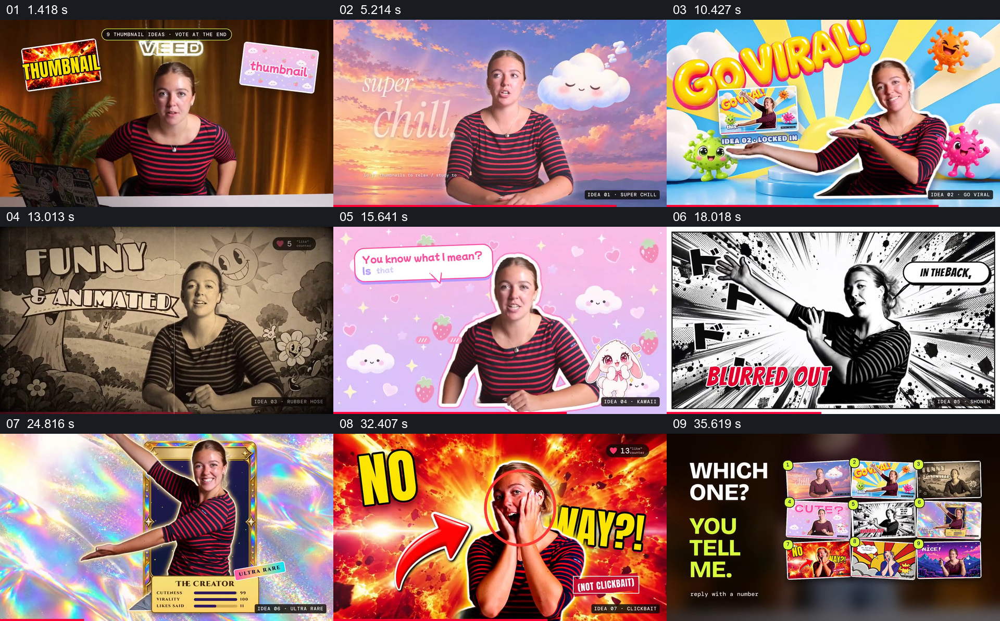

# 让同一位讲述者走进不同封面，最后把结果并排交给观众

- 作品：案例 001《人物口播、剪影与插画背景》，为库内索引名称。
- 原片范围：00:00.000–00:37.248。此卡覆盖整片，直接共用[完整原片／本卡片段](../video.mp4)。视频画面轨约至 37.246 秒，文件内声音轨至 37.248 秒。
- 范围依据：开头提出九种封面与结尾投票，之后的不同风格都服务于同一次选择；最终编号集合完成比较。因此没有按每次换风格拆成九张卡。
- 观察方式与未确认范围：查看整片 64 帧总览、本卡九宫格和后段补充分镜，并参考自动视频分析。没有独立完成连续原速观看与听审；抽帧之间的动作、准确节奏及声音配合仍待复核。下列对观看作用的解释是作品分析，不是作者自述。

[后段补充分镜：卡牌、回到桌前、三种封面与结尾](../storyboards/creative-c01-detail.jpg)。补充源时间依次为 25.526、27.027、29.029、30.530、31.532、32.407、33.033、33.825、34.618 秒。

## 原画面具体怎样设计

**先让观众认识共同主体与任务。** 开场是金色帘幕前的真实桌面：人物走近并坐在中间，桌面、左边的电脑和后方标识提供一个稳定的讲述环境。上方文字提示“九种封面、最后投票”，不同的小封面贴近人物两侧；随后搜索框与画内口播文字进入。此时人物占据中心，封面缩略图和文字说明接下来要比较什么。

**同一人物进入第一个成品，再回到讲述现场。** 约 00:05，人物仍以正面坐姿居中，原来的室内背景换成晚霞、云和“super chill”字样，形成第一套封面。主体并没有被另一个产品截图替代：相同的人物、衣服和前景位置保留，变化集中在周围世界及排印。随后画面回到金色房间，人物侧身、探身并展开手臂，画内短句出现在她旁边，接出下一种设想。

**让人物动作参与成品，而非仅置于背景前。** 约 00:08–00:11，人物被置于蓝黄放射背景前，夸张的“GO VIRAL”占据上方；彩色角色、太阳和云分布在周围。人物位于右侧，双手之间出现较小的成品封面，手势与小图构成直接关系。随后换成旧式黑白插画：人物居中，左侧树木、右侧花朵与上方“FUNNY & ANIMATED”共同组成画面。再往后，粉色草莓、云、对话框环绕人物；日漫段落又把人物转为黑白，放射线向她的伸手方向汇聚，对白框、局部特写与手臂共同进入漫画构图。

**回到现实姿态，扩展成另一种对象。** 约 00:21 后，画面回到桌前；人物站起并展开身体，随后进入彩色闪光的收藏卡画面。卡框在人物身后，姓名与属性条处于下方，她的手臂伸出框外；真人仍是主体，卡牌结构将她重新定义为一张可展示的“稀有卡”。约 00:29，房间再次出现，人物回到桌前，为后续另一组选择重新建立现实参照。

**将已出现的结果变成可比较的集合。** 约 00:32 起，同一人物的夸张表情先后出现在爆炸式封面、波普网点画面和像素风景里；背景、人物处理和文字随方案改变，人物身份仍可辨认。约 00:34.6 起，单个方案让位于最后的总览：左侧是“WHICH ONE? YOU TELL ME.”，右侧九张缩略图以三行排列并标号。观众的关注从正在演示的单一人物与风格，转到可以横向比较的九个结果，最终按编号回应。

## 为什么这样设计，好在哪里

这段的共同参照是人物，而不是某一种特效：她的衣着、脸和部分姿态跨越多种包装，使观众在看见变化时仍知道正在比较同一位创作者。晚霞段保留居中人物，收藏卡段让手臂越过框线，分别展示了“主体进入一种世界”和“主体与展示容器发生关系”；如果只把人物静照依次贴在九个背景上，就会丢失这些与表演相连的具体画面。

回到金色房间的几次间隔，让后面的大幅风格变化重新有了现实起点；画内短句先指向人物正在考虑什么，再由完整封面接管画面。九个结果到最后再次并列，观众不必只凭刚才的记忆做选择。去掉最后的编号集合，前面仍是风格演示，但“比较并选择”就少了一个明确的结果画面。

这些作用是依据可见构图和先后顺序作出的分析。静态抽帧无法证明每次转场的精确运动、音乐落点或实际观众反应；点赞计数与属性条也仅作为片中可见图形，不当作真实统计。

## 可直接使用的创意指令

当一个人物、产品或主题确有多种可以展示的视觉方案，且目标是让观众比较或选择时，先准备能被反复识别的共同主体，并明确每套方案真正不同的视觉处理。以一个清楚的现实环境或共同基准建立主体与选择任务，再让主体逐一进入各方案：背景、排印和图形需要一起构成该方案的实际画面，而不是只在同一主体旁贴不同风格名称。

素材允许时，让主体的真实姿势、方向或局部动作与方案中的对象发生具体关系，例如托住预览、跨出卡框、指向画内信息；主体不具备合适动作时，以稳定的主体位置和可识别轮廓承担比较基准。风格变化较大时，可按需要回到共同环境，再进入下一方案。最后把已展示过的结果以相近尺度、清晰编号重新并列，让选择文字对应实际可见的选项，并给予足以辨认差别的时间。

需要保留的是“同一主体可追踪—各方案确实呈现不同画面—结果被重新并列供比较”的关系；数量、人物或产品类型、背景、字形、画幅和具体动作都可依新内容重设。若只有一套成熟方案，或重点是逐项阅读大量细节，就不宜照搬原片快速汇集的方式。新题材中的迁移效果尚未实测。
