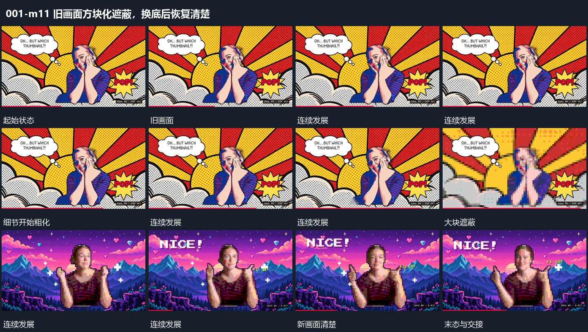

# 旧画面方块化遮蔽，换底后恢复清楚

## 运动指令

让旧画面的细节粗化为较大的方块状区域，借内容难以辨认的阶段更换底层，再恢复到清楚的新画面。新层完整出现后才开始下一组入场，避免在遮蔽未退时填入需要辨认的小内容。

## 视频切片

[播放本机制的原片切片](m11.mp4)

保留起始准备、连续发展和完成或明确交接；首尾按本段运动范围裁切，不拼接、不变速。尾部只保留理解结果所需的展示。

## 分镜过程

## 组合与调整

可以调整粗化强度，保证中间遮蔽确实覆盖交接位置。这里描述可见的方块化过程，不指定马赛克插件或某种作者算法。
