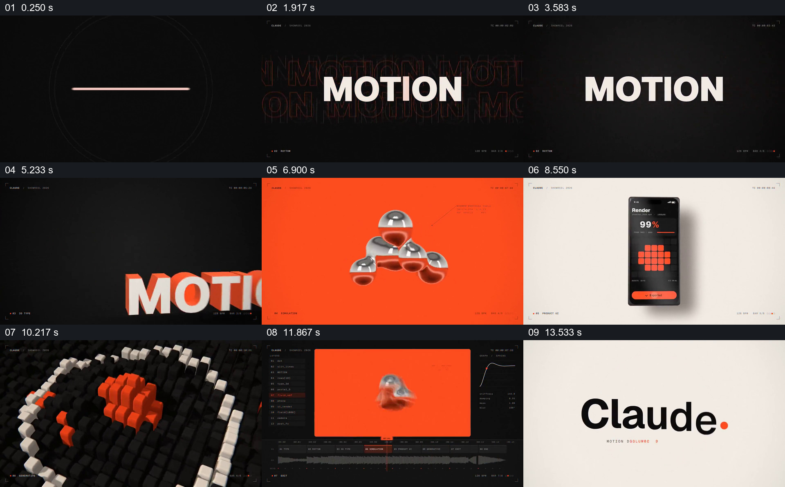

# 让同一运动主题穿过字形、立体物体与编辑界面

- 作品：案例 036《字形、立体对象与编辑界面》（索引名称）。
- 原片范围：00:00.000–00:14.930，含起点、不含终点；[完整原片](../video.mp4)｜[本卡片段](../video.mp4)。
- 观察方式：依据整片 64 宫格和约每秒一次的真实源帧观察，未连续原速观看或听审；声音、语气与完整播放节奏未确认。

## 原画面具体怎样设计

黑底红点与圆环引出白色 MOTION 字样，背景重复出现轮廓字；文字成为带红色侧面的立体形式。接着橙色背景出现银红色抽象物体，手机界面显示由橙色方块组成的图形，再切到黑底方块环与编辑软件画面，最后落到 Claude 标识。

## 为什么这样设计，好在哪里

相同的黑、白、橙红配色和运动主题连接不同表现，字体、物体和界面各提供一种观看尺度。抽帧不能完整说明快速运动过程，也不能确认各画面实际制作工具。

以上为依据画面的分析，非作者自述；预期观看效果未经观众测试。

## 可直接使用的创意指令

当要把多种视觉试验组织为一段作品展示时，先确定可贯穿的主题、色彩或形状关系，选择具有不同尺度和材料的实际作品，按可辨认的顺序展示并给出真实出处。具体切换节奏须通过连续播放审看，不以界面画面推断制作方式。
