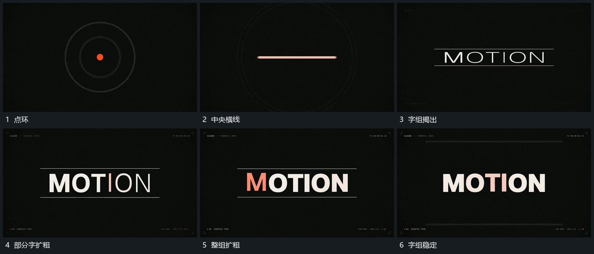

# 横线拉开上下边界，字组揭出后逐步扩粗

## 运动指令

让中央横线转成上下两条边界线，字组在两线之间揭出。文字完整后，字形从细到粗逐步变化，部分先变、后续再补齐，最终整组保持。

## 视频切片

[播放本机制的原片切片](m01.mp4)

覆盖分镜中“点环”至“字组稳定”的连续过程，并保留邻近的前后衔接画面；原片中交叠发生的动作一并保留。

## 分镜过程

## 组合与调整

可换字组，但保留从边界到内容的接续。字形变化需要可实现的字形或图形方案，不声称还原原作者方法。
