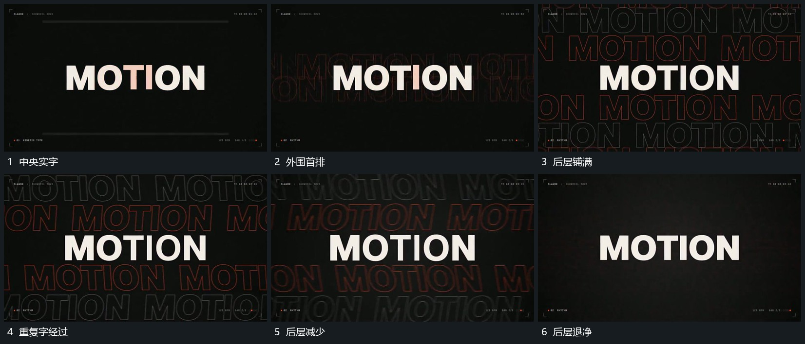

# 中央实字保持，后层轮廓字铺满后退净

## 运动指令

保留中央实字，在后层加入重复轮廓字，逐排铺开到画面边缘。让后层重复字继续经过，再逐步退去；中央字全程稳定，形成主形保持与外围活动的区别。

## 视频切片

[播放本机制的原片切片](m02.mp4)

覆盖分镜中“中央实字”至“后层退净”的连续过程，并保留邻近的前后衔接画面；原片中交叠发生的动作一并保留。

## 分镜过程

## 组合与调整

后层数量可以减少，保持前层可读，不能让复制字覆盖主字到无法辨认。
