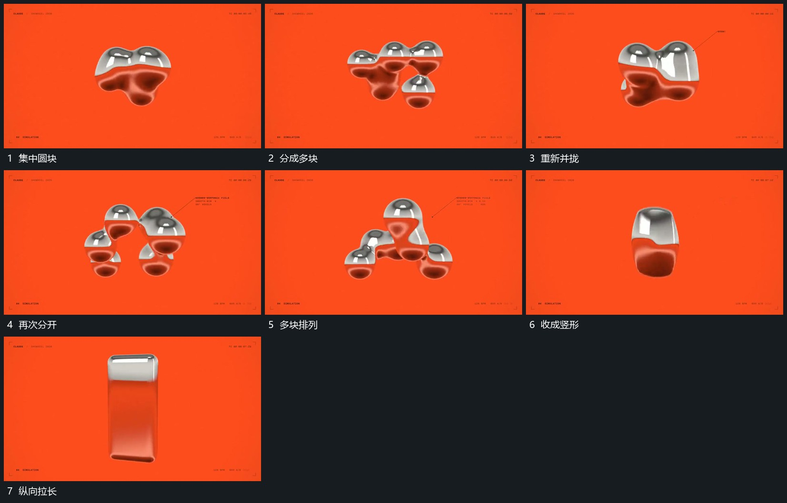

# 圆块群反复分合，收成竖形后拉长

## 运动指令

让中央圆块群从集中状态分成多个小块，再并回较大主形，继续一次分合变化。末尾将块群收成竖向主形，再沿纵向拉长，给下一竖框提供接管方向。

## 视频切片

[播放本机制的原片切片](m04.mp4)

覆盖分镜中“集中圆块”至“纵向拉长”的连续过程，并保留邻近的前后衔接画面；原片中交叠发生的动作一并保留。

## 分镜过程

## 组合与调整

不按单帧假定真实液体算法。保留分与合的节奏，并用清楚的收束结束循环。
